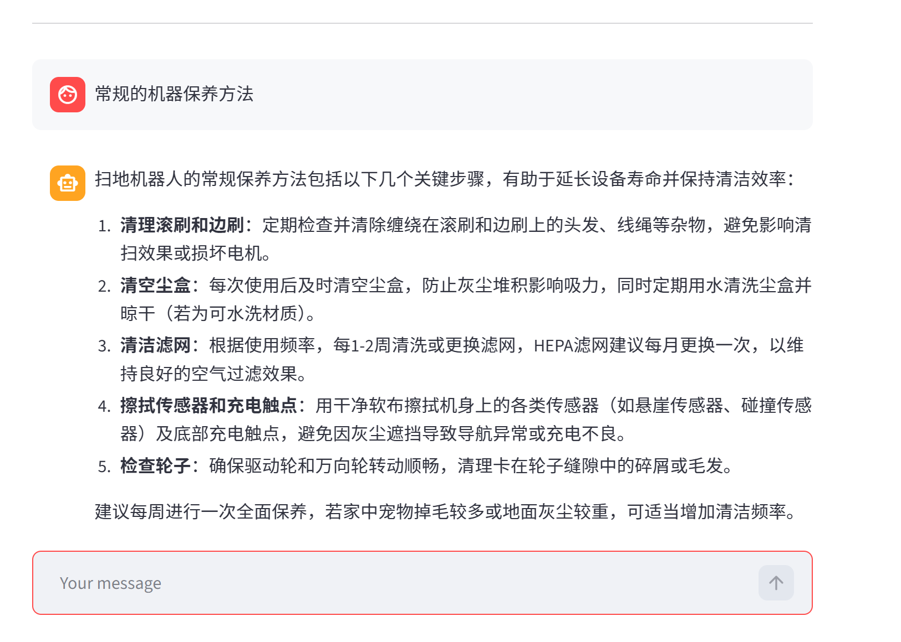
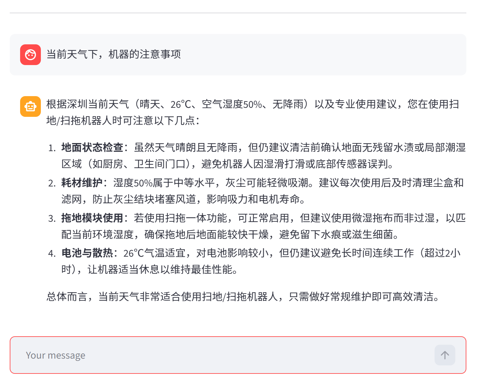
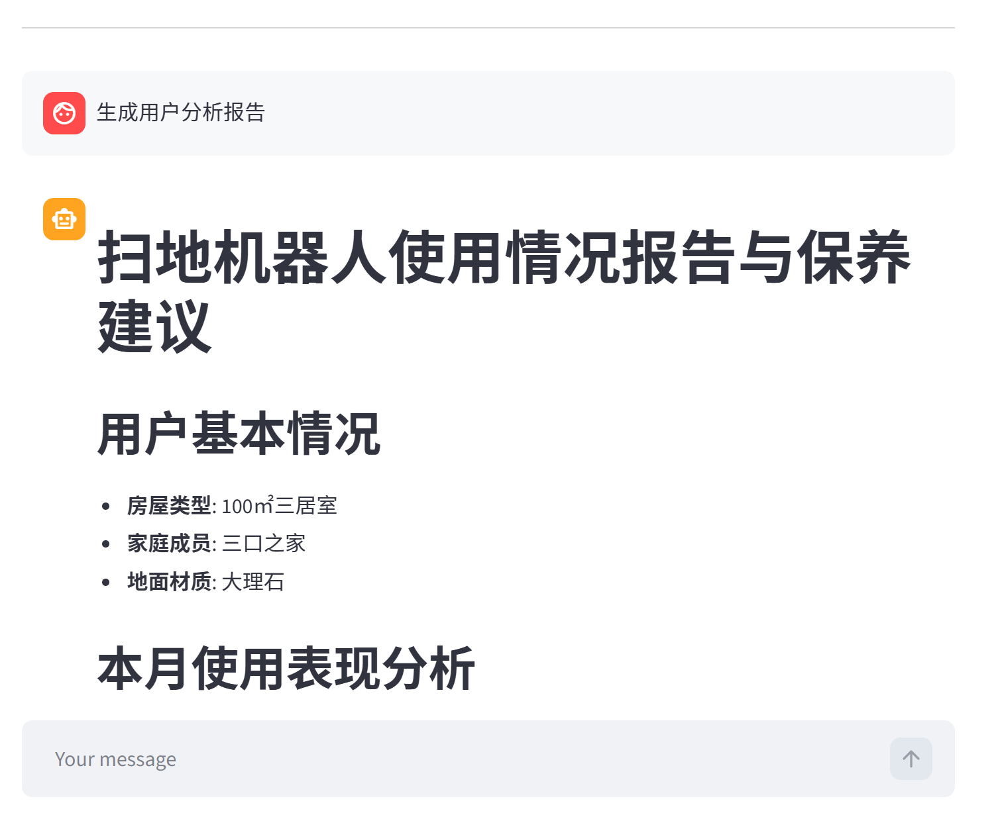

<div align="center">

# Agent Harness · 多场景工具调用 Agent 运行时与评测

**基于 LangChain 1.x + LangGraph 的 Agent Runtime / Harness：工具调用、规划/路由、MCP、上下文、记忆、工作流与 outcome 评测；覆盖办公 / 学习 / 内容 / 跨语言、研究、编码与模拟智能硬件客服**

> 当前版本：**v0.2（2026-11-02 面试增补）**。边界见 [docs/PROJECT.md](./docs/PROJECT.md) 第 9 节。
> 项目边界、能力范围与 AgentGuide 对照：[docs/PROJECT.md](./docs/PROJECT.md)
> 当前结果总览：[docs/benchmarks/current-results.md](./docs/benchmarks/current-results.md)
> 面试主结果页：[docs/interview/jd-results-2026-11-04.md](./docs/interview/jd-results-2026-11-04.md)

[](https://www.python.org/)
&nbsp;
[](https://www.langchain.com/)
&nbsp;
[](https://github.com/langchain-ai/langgraph)
&nbsp;
[](https://www.trychroma.com/)
&nbsp;
[](https://streamlit.io/)
&nbsp;
[](./LICENSE)

</div>

---

## 项目简介

本项目是基础项目 **KnowledgeBase-RAG-LLM-System** 的 Agent 演进版，定位是一个**带评测的 Agent Harness**：

- **基础项目**负责 RAG 底座：四格式文档解析、按类型切片、MD5 去重、Chroma 持久化、纯向量 / 混合检索对比；
- **本项目**负责把裸模型包装成可运行、可约束、可评测的 Agent：ReAct 循环、8 个场景 / 40+ 工具注册与调度、参数校验与错误重注入、确定性 planning policy、上下文压缩、PII 脱敏、HITL 审批、多轮记忆、步数与工具调用上限；
- **多场景验证**：办公 / 学习 / 内容 / 跨语言（workspace_assistant）、研究调研（research_assistant）、编码运行时（coding_demo）、模拟智能硬件客服（robot_vacuum）；框架与业务通过 `Scenario` 注册机制解耦，换业务只需新增场景，不需要改运行时。

系统能根据用户意图自动路由到目标场景，再由场景 Agent 调用工具和知识库完成推理；同时内置行为评测、outcome 断言、BFCL / τ²-bench / RAG 抽样与失败集，能定位 Agent 在哪一层坏掉。

## 框架与业务场景分离

项目已把「Agent 框架」和「预设业务场景」拆开：

```text
core/agent/framework.py          # 通用 ReAct 运行时：create_agent + 中间件 + 流式输出
core/agent/contracts.py          # Scenario 契约：模型 / 提示词 / 工具 / 中间件 / context / 测试用例
core/scenarios/registry.py       # 场景注册表
core/scenarios/robot_vacuum/     # 预设业务场景：7 个工具 + 提示词 + 中间件 + cases.jsonl
core/interfaces/react_agent.py   # 兼容层：默认加载 robot_vacuum，保持原 API
test_entry.py               # 统一测试入口
core/quality/agent_eval.py       # 行为层评测：FrameworkAgent 跑场景 cases
```

- 框架层**不 import 任何业务工具**；
- 新增场景只需在 `core/scenarios/<name>/` 实现 `build_scenario()` 并在 `registry.py` 注册；
- `react_agent.py`、`app.py`、`core/interfaces/examples/demo_agent_interfaces.py` 的原有用法不变。

## 测试入口

```bash
python test_entry.py --list          # 列出场景和用例
python test_entry.py --all           # 跑全部用例
python test_entry.py --case agent-rag-001
python test_entry.py --interactive   # 交互式对话
python test_entry.py --all --judge   # 加 LLM-as-judge
python test_entry.py workflow --list # LangGraph 工作流
python test_entry.py workflow --run rag_qa --dry-run
```

报告输出到 `outputs/agent/`。

## 场景矩阵与总路由

`router` 是一个对话式前台，不直接处理专业任务，只通过四个路由工具分流：

```text
route_to_workspace   → workspace_assistant   办公 / 学习 / 内容 / 信息管理 / 跨语言
route_to_coding      → coding_demo           编码 / 文件 / 测试 / 修复
route_to_robot       → robot_vacuum          扫地/扫拖机器人设备与使用
route_to_research    → research_assistant    多资料对比 / 研究调研
```

每个目标场景仍然独立拥有自己的工具、提示词、checkpoint 和 trace；路由只调用目标
`FrameworkAgent`，不把四个场景的工具合并进一个 Agent。

新增场景：

- `workspace_assistant`：`search_notes / read_note / write_note / remember / recall / translate / summarize`；
  LangGraph：`document_qa / study_notes / cross_lingual / content_draft`；
- `research_assistant`：`list_sources / read_source / search_sources / write_report / subagent`；
  LangGraph：`deep_research`（只读 subagent fan-out → 汇总 → 引用 → 报告）；
- `router`：四个 `route_to_*` 工具；对话端默认的“综合助手”入口。

示例：

```bash
python -m core.quality.runner agent --scenario router --case router-workspace-001
python -m core.quality.runner agent --scenario workspace_assistant --case workspace-qa-001
python -m core.quality.runner agent --scenario research_assistant --case research-compare-001
python -m core.interfaces.workflow_cli --scenario workspace_assistant --run document_qa --input "Agent 评测应该关注哪些指标？"
python -m core.interfaces.workflow_cli --scenario workspace_assistant --run study_notes --input "学习计划"
python -m core.interfaces.workflow_cli --scenario research_assistant --run deep_research --input "对比三份资料"
```

> 新场景已完成 3-trial 行为回归（workspace 5/5、research 2/3、router 3/4）与 12 条
> outcome 断言；评测口径见 [docs/benchmarks/current-results.md](./docs/benchmarks/current-results.md)。

## Planning Policy 与 Outcome 评测

**Planning Policy**：`core/agent/middleware/planning.py` 在第一次模型调用前按规则注入
`route_to_*` / `subagent` / `create_task`；不命中、分数不足或平局时 abstain，交回模型。
它不是自主 planner，而是可测、可审计的 Harness 决策。

```bash
python -m core.experiments.planner_eval --trials 1
python -m core.experiments.trigger_rate --variants natural,routed,policy
```

结果（12 条路由 / 10 条 coding 委派）：

```text
router:  baseline 11/12 → policy 12/12；平均模型调用 1.92 → 1.08；1 条 abstain 后模型兜底正确
coding:  natural 0/10、routed 0/10、policy eligible 3/10 → 3/3 触发，7/10 保持不委派
```

**Outcome 评测**：`core/quality/outcome_eval.py` 检查运行后的真实环境状态，而不是回答文本。

```bash
python -m core.quality.runner outcome --all --trials 3
```

覆盖 12 条断言：workspace 笔记文件 / SQLite 长期偏好、research 报告文件与多源引用、
coding 脚本 + 运行日志 + 任务图 `completed`、router 的 `target` + `target_trace_id`。
报告写到 `outputs/outcome/`，每条失败能定位到具体 check。

## RAG / LLM 评测

`data/evals/` 保存数据集，`core/quality/` 保存评测代码，报告写到 `outputs/`。
能力层（RAG 检索/生成、RGB/MultiHop）走 `FrameworkAgent.invoke_tool`，
行为层（44 条用例，支持 `--trials` 跑 pass^k）走 `FrameworkAgent.invoke`：

```bash
python -m core.quality.runner agent --limit 2          # 行为层
python -m core.quality.runner agent --scenario workspace_assistant --trials 3
python -m core.quality.runner agent --scenario research_assistant --trials 3
python -m core.quality.runner agent --scenario router --trials 3
python -m core.quality.runner outcome --all --trials 3 # outcome 层
python -m core.quality.runner rag retrieval --limit 5  # 能力层：检索
python -m core.quality.runner rag generation --limit 5 # 能力层：生成
python -m core.quality.runner public --rgb-limit 2 --skip-multihop
python -m core.quality.runner bfcl --simple 2 --irrelevance 2

# 任务级夹具：按任务配工具，不借用产品场景
python -m core.quality.fixtures --family bfcl --limit 3 --dry-run
python -m core.quality.fixtures --family bfcl --limit 3
python -m core.quality.fixtures --family permission

# 兼容旧入口
python test_entry.py rag retrieval
python test_entry.py rag generation
python test_entry.py rag judge
python test_entry.py benchmark public
```

数据在 `data/evals/datasets/`（42 条业务集 + RGB 20 条 + MultiHop-RAG 12 条），
报告输出到 `outputs/rag/`。详见 [data/evals/README.md](./data/evals/README.md)。

### 当前评测结果（抽样，非官方完整分数）

| 评测 | 规模 | 指标 | 结果 |
|:---|:---:|:---|:---|
| BFCL v4（工具调用） | 200 | 函数选择 / 参数 exact / 无关请求不调用 | 100/100 · 90/100 · 79/100 |
| τ²-bench retail（多轮工具 + 政策） | 20 | Pass^1 / DB 状态 | 0.95 · 20/20 |
| 自建 RAG 业务集 | 42 | 总通过 / 拒答准确 | 37/42 · 10/10 |
| RGB（抽样） | 20 | Hit@4 / MRR | 16/16 · 0.875 |
| MultiHop-RAG（全量） | 2255 | Hits@4 | 57.1%（95% CI 55.0–59.1） |
| Agent 行为回归（旧） | 13 | 通过率 | 11/13（工具类 13/13，2026-10-29 快照） |
| 新场景 3-trial（2026-11-02） | workspace 5 / research 3 / router 4 | pass^k / mean | 5/5 · 2/3 · 3/4 |
| Outcome 用例（13 断言，2026-11-02） | 12 | 文件 / SQLite / 任务图 / 路由 trace | 12/12（3-trial） |
| Planning Policy（2026-11-02） | 12 路由 | 准确率 / 模型调用 | 12/12 · 1.08（baseline 11/12 · 1.92） |

> BFCL 为 v4 抽样；τ²-bench 的 NL assertion judge 使用 DeepSeek 替代默认 OpenAI judge，
> 不是官方评分口径。失败案例统一归档在 `data/evals/failures/`。
> Agent 回归为单次运行，生成有波动；`agent-rag-006` 是已知的覆盖判定争议案例。
> RAG 42 条业务集是服装域历史结果，与当前扫地机器人知识库不匹配，不应作为当前结果引用。

## Harness 能力补全（参考 learn-claude-code）

> Agent 优化方向的持续整理见 [docs/design/agent-optimization-landscape.md](./docs/design/agent-optimization-landscape.md)（16 个方向 + JD 映射 + 优先级 backlog）。
> 简历项目叙事见 [docs/interview/resume-project-narrative.md](./docs/interview/resume-project-narrative.md)（2 分钟稿 + 简历 bullet + 追问清单 + 半周计划）。
> 公开 Agent 基准方案见 [docs/benchmarks/public-benchmark-plan.md](./docs/benchmarks/public-benchmark-plan.md)（τ²-bench 为主、BFCL 为辅，Agent-first）。

用 LangChain 1.x 内置中间件补齐了 Harness 层能力，业务层不用重复实现：

| learn-claude-code | LangChain 封装 | 本项目落点 |
|:---|:---|:---|
| s03 Permission | `HumanInTheLoopMiddleware` | `reset_device` 高风险工具；模型可能先自拒答，审批作为第二层保护；`core/tests/demos/hitl_demo.py` |
| s05 Todo Write | `TodoListMiddleware` | 自动注入 `write_todos` 工具 |
| s08 Context Compact | `SummarizationMiddleware` | 30 条消息触发，保留最近 12 条 |
| s09 Memory | `InMemorySaver` / `SqliteSaver` + `thread_id` | 同一 thread 保留多轮历史；SQLite 跨实例/重启保留；`core/tests/demos/memory_demo.py`、`core/tests/persistent_memory_demo.py` |
| s11 Error Recovery | `ToolRetry` / `ModelRetry` / `ModelFallback` / `ToolError` | 工具与模型重试、异常回注（fallback 可配置） |
| s03 PII | `PIIMiddleware` | email / credit_card / ip 脱敏 |
| 工具循环控制 | `ToolCallLimitMiddleware` | 单次 run 最多 12 次工具调用 |
| 工具权限 | `ToolPermissionMiddleware`（自研） | `tool_policy` 的 allow / deny / risk_levels；deny 直接返回 error ToolMessage |
| 工具超时 | `ToolTimeoutMiddleware`（自研） | 默认 30s，`rag_summarize` 60s；超时返回 error ToolMessage |
| Token 预算 | `TokenBudgetMiddleware`（自研） | 单次 run 累计 token 上限，含 RAG 工具内部模型调用；超限返回兜底 |
| 可观测性 | `TraceCallbackHandler`（自研） | 模型/工具/token/耗时写 `outputs/traces/*.jsonl`；`python test_entry.py trace --last 10` |
| s12 Task System | `TodoListMiddleware`（部分） | 任务清单；完整依赖图未实现 |
| s06 Subagent / s07 Skill / s13-14 后台任务 / s18 Worktree / s19 MCP | 暂未引入 | 需要独立运行时或外部服务，当前客服场景优先级低 |

配置入口在 `core/agent/contracts.py` 的 `Scenario`：`high_risk_tools`、`fallback_model`、
`enable_todo`、`enable_summarization`、`tool_call_limit`、`pii_types`、`checkpoint`、
`checkpoint_backend`、`checkpoint_path`、`tool_policy`、`tool_timeout_seconds`、`tool_timeouts`。

```bash
python core/tests/demos/hitl_demo.py --decision reject
python core/tests/demos/memory_demo.py
python core/tests/persistent_memory_demo.py   # 两个实例共享 SQLite checkpoint
python core/tests/token_budget_demo.py        # 低预算截断演示
python test_entry.py trace --last 10     # 查看最近 trace
python test_entry.py workflow --list
python test_entry.py workflow --run rag_qa --dry-run
```

## 可观测性与持久化

### 1. 本地 trace（不依赖 LangSmith）

`core/observability/tracer.py` 实现 `TraceCallbackHandler`，作为 callback 挂到
`agent.invoke/stream` 的 config 上，记录：

- 每次模型调用的模型名、耗时、prompt/completion/total tokens；
- 每次工具调用的工具名、参数、耗时、状态；
- 一次 run 的 `run_end` 汇总：模型/工具调用次数、token 总量、总耗时、cost 估算。

事件追加写入 `outputs/traces/trace_YYYYMMDD.jsonl`，一行一个事件：

```bash
python test_entry.py trace --last 10
python test_entry.py trace --trace-id run-xxxx
```

token 直接取 LangChain 的 `usage_metadata` / OpenAI 的 `token_usage`；
cost 只有在 `config/observability.yml` 配置了价格时才计算，避免写死不准的价格。

### 2. SQLite 会话持久化

`core/agent/checkpoint.py` 提供 `build_checkpointer(backend, path)`：

- `memory`：`InMemorySaver`，进程内记忆，重启即丢；
- `sqlite`：`SqliteSaver` 写 `data/runtime/agent_checkpoints.sqlite`，跨实例/重启保留。

`core/scenarios/robot_vacuum/config/agent.yml` 的 `checkpoint_backend` / `checkpoint_path` 控制。
`core/tests/persistent_memory_demo.py` 用两个独立的 `ReactAgent` 实例验证：
第一个实例说“我叫小明”，销毁后第二个实例用同一个 `thread_id` 仍能回答。

### 3. 工具权限与超时

- `ToolPermissionMiddleware`：按 `tool_policy` 做 allow / deny；deny 不执行工具，
  直接返回 `status="error"` 的 ToolMessage，模型看到后改路；
- `ToolTimeoutMiddleware`：默认 30s，`rag_summarize` 60s；同步链路放线程池，
  异步链路用 `asyncio.wait_for`，超时返回 error ToolMessage。
- 顺序：权限（最外层）→ 业务中间件 → HITL → 超时 → `ToolError` → `ToolRetry` → 工具调用上限 → 工具。
  权限在最外层，deny 的工具不会进入审批/执行；超时在 HITL 内层，人工审批时间不计入工具超时；
  `ToolError` 在 `ToolRetry` 外层，重试耗尽后才把异常转成 error ToolMessage。

### 4. Token 预算

- `core/observability/budget.py` 的 `RunBudget` 记录单次 run 的累计 token；
- `TraceCallbackHandler` 在所有模型调用结束后累加，**包含 RAG 工具内部的总结模型调用**；
- `TokenBudgetMiddleware` 在每次模型调用前检查，超限直接结束并返回兜底回复；
- `core/scenarios/robot_vacuum/config/agent.yml` 的 `token_budget` 控制上限；
- trace 的 `run_end` 会写 `budget_limit`、`budget_used`，超限时 status 为 `budget_exceeded`。

验证：把预算临时设为 200，RAG case 实际用了 5560 tokens，在下一次模型调用前被截断并返回预算提示。

## 效果展示

<div align="center">



*图1. 普通问答 — RAG 检索知识库回复*

&nbsp;



*图2. Agent 工具调用 — 实时展示推理与工具执行链路*

&nbsp;



*图3. 工具调用详情 — 多步推理与中间结果可视化*

</div>

## 技术架构

```text
用户输入 (Streamlit)
      │
      ▼
┌────────────────────────────────────────────────────┐
│                    ReAct Agent                     │
│                                                    │
│   Thought ──→ Action ──→ Observation ──→ Thought   │
│      │           │             │                   │
│      │           ▼             │                   │
│      │      工具调用           │                   │
│      │   （参数校验/异常兜底）  │                   │
│      └─────────────────────────┘                   │
│                                                    │
│   Middleware：                                     │
│   intent_router → 动态提示词（qa / report）         │
│   validate_tool_args → 非法参数 error 重注入        │
│   limit_steps → 最大模型调用步数限制                │
│   monitor_tool / log_before_model → 全链路日志      │
└───────────────┬──────────────────────┬─────────────┘
                │                      │
                ▼                      ▼
      ┌──────────────────┐    ┌──────────────────┐
      │   RAG 检索增强    │    │    业务工具       │
      │  向量 + BM25 混合  │    │ 天气/定位/用户ID   │
      │  Chroma 持久化     │    │ 月份/外部使用记录  │
      └──────────────────┘    └──────────────────┘
```

### 核心特性

| 特性 | 说明 |
|---|---|
| **ReAct 范式** | Thought → Action → Observation 循环，Agent 自主推理并决定调用哪个工具 |
| **RAG 检索增强** | 支持 **txt / pdf / docx / md** 四种格式；按文件类型差异化切片；MD5 去重（带来源）+ 内容更新替换；Chroma 本地持久化 |
| **混合检索** | 纯向量 vs 向量 + BM25 关键词兜底（jieba 分词 + 加权 RRF 融合），Top-K 可配置 |
| **7 个工具** | `rag_summarize` / `get_weather` / `get_user_location` / `get_user_id` / `get_current_month` / `fetch_external_data` / `reset_device`（高风险，走 HITL） |
| **参数校验中间件** | 拦截非法工具参数（如 user_id 非数字、month 格式错误），以 `status="error"` 的 ToolMessage 重注入 Agent 循环，促使模型修正后重新规划 |
| **意图路由 + 切换日志** | `agent.yml` 关键词规则识别「报告生成 / 普通问答」，首轮模型调用前切换提示词；切换记录写入独立日志，便于 badcase 复盘 |
| **最大步数限制** | `max_model_calls` 控制 ReAct 循环上限，超限返回中文兜底回复，避免死循环和 token 浪费 |
| **YAML 全面驱动** | 模型、Top-K、混合权重、检索模式、按类型切片参数、提示词模板、意图关键词、步数上限均可配置 |
| **流式对话界面** | Streamlit 构建，支持流式输出、历史消息留存、工具调用过程可见 |

## 技术栈

| 层级 | 技术 |
|---|---|
| LLM / Embedding | DeepSeek `deepseek-chat` / BAAI `bge-small-zh-v1.5`（本地 CPU） |
| Agent 框架 | LangChain 1.4.2 + LangGraph 1.2.12 |
| 向量数据库 | Chroma 1.5.9（本地持久化） |
| 检索 | 向量检索 + 手写 BM25 + 加权 RRF（`langchain-classic` EnsembleRetriever） |
| 文档处理 | pypdf / python-docx / RecursiveCharacterTextSplitter |
| 中文分词 | jieba（未安装时自动降级为 bigram） |
| 前端 | Streamlit 1.40 |
| 配置 | YAML 驱动（Agent / RAG / Chroma / Prompts） |

## 快速开始

### 环境要求

- **Python** ≥ 3.10
- **DeepSeek API Key**（[platform.deepseek.com](https://platform.deepseek.com/) 申请）
- 本地 Embedding 模型约 100MB，首次运行需下载

### 1. 克隆仓库

```bash
git clone https://github.com/Stormlittleliu/agent-harness.git
cd agent-harness
```

### 2. 安装依赖

```bash
pip install -r requirements.txt
```

### 3. 配置 API Key

参考 `.env.example`，设置 DeepSeek API Key：

```bash
# Linux / macOS
export DEEPSEEK_API_KEY="your-api-key"

# Windows (CMD)
set DEEPSEEK_API_KEY=your-api-key
```

> 也可以在项目根目录创建 `.env` 文件，写入 `DEEPSEEK_API_KEY=your-api-key`（`core/llm/factory.py` 会自动加载）。

### 4. 下载本地 Embedding 模型（首次运行）

```bash
python -c "from modelscope import snapshot_download; snapshot_download('BAAI/bge-small-zh-v1.5', local_dir='data/models/bge-small-zh-v1.5')"
```

模型约 100MB，CPU 即可运行；`config/rag.yml` 的 `embedding_model_name` 已指向该目录。

### 5. 初始化知识库（首次运行）

```bash
python -c "from core.tools.rag.vector_store import VectorStoreService; VectorStoreService().load_document()"
```

该命令会读取 `data/knowledge/` 下所有允许类型的文档，解析、切片并分批写入 Chroma。重复执行会自动跳过未变化的文件；文件内容变化时会替换旧分块。

### 6. 启动应用

RAG / 对话入口：

```bash
python run_dashboard.py --app app_rag.py
```

Agent 控制台（对话 / 构建 / 质量三个产品）：

```bash
python run_dashboard.py
```

启动器会自动从 8501 开始找空闲端口，并在终端打印实际 URL（例如
`Dashboard: http://localhost:8502`）。也可以指定端口：

```bash
python run_dashboard.py --port 8600
```

控制台按“工作对象”分成三个产品，URL 分开、状态各自隔离：

| 入口 | 工作对象 | 说明 |
|---|---|---|
| `/?app=chat` | 一次会话 | 只列**已发布**的场景；多轮对话，每轮可展开“这次怎么答的”（调用链 + 节点说明 + trace） |
| `/?app=build` | 一个场景 | 场景库 → 场景详情：概览 / 结构（画布、表单）/ 工具与策略 / 发布；`coding_demo` 多一个运行窗口 |
| `/?app=quality` | 一次运行 | 评测 / 复核 / 优化 / 自检 / 数据集 / 基准 / 成本 / 记录（数据集的结构化改造还没做） |

场景不再是全局侧边栏：对话页只在自己的入口里切换（每个入口一条独立会话线程），
构建页由路由携带场景（`?app=build&scenario=router`），质量页的场景选择只影响评测对象。
所以换场景不会再把编辑器草稿、评测筛选、表格选择一起清掉。

**发布是显式动作**：在「构建 → 发布」里先静态校验（spec 能编译、工具在工具箱里、
提示词块齐全、节点都有中文说明），通过才写 `data/specs/<name>/entry.yml`；
改完结构没重新发布，入口仍按上次发布的状态，构建页会标“有未发布改动”。

- **结构**：受约束的低代码编辑器，把 `data/specs/<name>/` 变成可跑的场景——**可视化画布**里从块库拖块、连线、移动节点（点连线删除，校验错误会把节点标红），下面的面板改节点 id 与参数（参数按 `ParamSpec` 自动渲染，复合块如 `react_loop` 的内部参数也在同一张表单里），也可切成表单模式逐节点展开；改基本信息 / 工具白名单 / harness 开关，**保存前先编译预览**，存成新版本 spec；支持载入历史版本、下载草稿 JSON 与单向 `eject`。画布是单文件原生 JS，无 npm、无外部 CDN；
- **工具与策略**：工具、风险等级、中间件链、LangGraph 工作流图；中间件链是一排中文胶囊（由外到内），**鼠标悬停**看每条策略的职责、分层（守卫 / 上下文 / 可靠性 / 成本）、slot 与源码位置；日志类合并成一行，展开可见配置；
- **发布**：入口标题 / 一句话介绍 / 开场白 / 排序 + 校验 + 撤回；“开始对话”就是这条入口；
- **对话**：多轮会话（checkpointer 记忆），每轮回答下可展开调用链与逐条 trace；高风险工具被 HITL 拦下时，直接在同一处批准 / 拒绝；
- **质量页**：测试用例直接跑 `cases.jsonl` 并复用 `core.quality.agent_eval` 的评分（按通过/失败、判定依据、类别筛选，可点开看命中要点、工具调用、回答与 trace）；评测页合并场景行为/outcome 报告、成本/时延、公开基准与评测记录；复核页做 LLM judge + 人工标注；优化循环读 `outputs/demo/`；Benchmark 目录读 `data/benchmarks/`；
- **运行窗口**（`coding_demo`）：任务图看板、任务详情、命令日志，可对 ready 任务执行 Agent。

数据页顶部会标注文件更新时间；报告、样例集与 trace 索引按 path + mtime 缓存，表格默认最多展示 200 行（下载 CSV 包含全部筛选结果），缺失或部分缺失时显示可执行的生成命令。测试用例详情新增“对象链路”：从案例直接定位场景、工具、中间件、评测函数与 trace 的 `module:line`；工具卡可跳转架构页，架构页工具表也可反查相关用例。另有“按对象浏览”，按工具聚合案例与通过率。评测记录页只读扫描 `outputs/`，不会重新运行评测或触发模型调用；超大 JSON 超过解析上限时退化为 summary 预览。优化循环页面每次加载只检查一次文件状态，不会自动轮询，后台评测写入后可手动刷新页面。

### 7. 统一 benchmark 样例集

```bash
# 查看适配器与本地可用性
python -m core.benchmarks.catalog --list

# 每个来源分层抽 12 条，固定 seed
python -m core.benchmarks.catalog --build --per-source 12 --seed 42
```

把 τ²-bench、BFCL、RGB、MultiHop-RAG、SWE-bench、WebArena、OSWorld 等公开任务统一成 `BenchTask`，按来源和类别分层抽样，输出：

```text
data/benchmarks/catalog.jsonl
data/benchmarks/manifest.json
data/benchmarks/catalog.md
```

当前 `--per-source 40` 会生成 **8 个来源 × 40 = 320 条**样例。GAIA 是 gated dataset，已下载 165 条 validation；重新下载需要先设置 `HF_TOKEN` 并接受数据集条款：

```bash
python -m core.benchmarks.download_gaia --proxy http://127.0.0.1:7897
```

SWE-bench / WebArena / OSWorld 的数据已本地化，但执行仍分别需要 Docker、自托管网站和 VM。

### 8. 最小优化循环 Demo

```bash
python -m core.experiments.optimize --iterations 5
```

用 BFCL 工具调用 + MultiHop-RAG 检索跑一个完整的“跑 → badcase 归因 → 定向改 → 复跑 → 查回归”循环；默认 3 倍样本、每个 case 3 trial，优化方向按 prompt / tool / retrieval / query planning / loop 分类。当前最佳组合是 `bfcl_fixes`：BFCL 60/60（两轮 3-trial 复跑）、RAG 44/45（与 hybrid 一致，0 回归）。报告见 `outputs/demo/report.md`，复盘见 [docs/benchmarks/optimization-loop-3x.md](./docs/benchmarks/optimization-loop-3x.md) 和 [docs/benchmarks/bfcl-fixes.md](./docs/benchmarks/bfcl-fixes.md)。

### 9. MCP 演示（Memory + Fetch）

```bash
python -m core.quality.runner agent --scenario mcp_demo
```

- **Memory MCP**：官方 Node server，跨会话保存/检索用户偏好（JSONL 落盘）；
- **Fetch MCP**：本地 server，读取 allowlist 域名下的网页文本，默认禁止私网，返回内容标记为 untrusted；
- MCP async 工具通过常驻事件循环包装成同步 LangChain 工具，原有 CLI / Streamlit / 评测链路不用改。

控制台切到 `mcp_demo` 可以看架构、任务执行和 3 条测试用例。详见 [core/mcp/README.md](./core/mcp/README.md)。

### 10. 运行时扩展：hooks / Todo / 任务图 / 文件 / 运行窗口

`core/runtime/` 是独立的运行时层，场景通过 `Scenario.runtime` 配置：

- **Hooks**：`UserPromptSubmit` / `PreToolUse` / `PostToolUse` / `Stop` / `TaskStart` / `TaskComplete` / `TaskFail`；
- **Todo**：`TodoListMiddleware` 自动注入 `write_todos`，多步骤任务先列计划再执行；
- **任务图**：SQLite 持久化，`pending / in_progress / completed / failed` + `blocked_by` 依赖；
- **文件工具**：`read_file` / `write_file` / `edit_file` / `glob` / `grep`；写操作限制在工作区内，默认不覆盖已有文件，`edit_file` 要求 `old_text` 唯一；
- **命令执行**：`run_command`，危险命令拒绝，输出写入 `data/runtime/run_window/`；
- **运行窗口**：控制台「运行窗口」页展示任务图、任务详情、命令日志，并可执行 ready 任务；
- **Subagent**：`subagent` 工具派生单层子 Agent，fresh context、工具白名单、超时/预算/步数，只返回摘要。

示例场景：

```bash
python -m core.quality.runner agent --scenario coding_demo
python -m streamlit run app_agent.py   # 打开构建页选 coding_demo
```

详见 [core/runtime/README.md](./core/runtime/README.md)。

### 11. 测试

```bash
python -m pytest
```

当前 **283 passed**。覆盖任务图依赖 / 持久化、workspace 读取 / 写入 / 编辑 / grep 与受保护目录拒绝、workspace / research 场景工具、总路由 / 子场景入口、场景 / MCP / LangGraph 边界、planning policy、outcome 断言、trials 聚合、metrics 的
`expected_tools_any`、subagent 子上下文 / 工具白名单、hook 触发与异常隔离、结构化输出
schema、成本报告聚合、评测门禁、故障注入（超时 / 权限 / 参数 / 空检索 / 拒答）、
对象索引（工具 / 中间件源码定位）、完整报告选择、中间件中文说明与顺序不变量、
spec 场景的编译 / 归属守卫 / 草稿编辑与版本化、trace 的 LangGraph 节点归因、
节点说明覆盖率（每个工作流节点都必须有中文说明）、控制台路由与三个产品的渲染、
对话入口的发布 / 撤回 / 结构漂移，以及控制台 AppTest 启动与逐页签渲染。

### 验证运行

启动后在聊天框输入以下测试问题：

- *扫地机器人有哪些主要功能？*（RAG 知识库问答）
- *如果机器人无法正常回充，该如何处理？*（故障排查 + 工具调用）
- *给我生成我的使用报告*（意图路由切换报告提示词 + 多工具组合）

## 项目结构

```text
agent-harness/
│
├── core/                              # 代码
│   ├── agent/                         #   L1 Harness
│   │   ├── contracts.py               #     Scenario / Tool / Workflow 契约
│   │   ├── framework.py               #     ReAct loop + 中间件装配
│   │   ├── hooks.py                   #     HookManager + Pre/Post tool middleware
│   │   ├── subagent.py                #     单层子 Agent（fresh context）
│   │   ├── checkpoint.py              #     memory / sqlite checkpointer
│   │   ├── workflow.py                #     WorkflowRuntime
│   │   └── middleware/
│   │       ├── generic.py             #     日志 / 参数校验 / 步数限制
│   │       ├── policy.py              #     权限 / 超时
│   │       └── budget.py              #     token 预算
│   │
│   ├── tools/                         #   L2 能力层
│   │   ├── business/
│   │   │   ├── constants.py
│   │   │   └── tools.py               #     7 个业务工具
│   │   └── rag/
│   │       ├── embedding.py           #     本地 BGE / DashScope
│   │       ├── vector_store.py        #     Chroma 入库 / MD5 去重
│   │       ├── retrievers.py          #     向量 / BM25 / 混合检索
│   │       ├── service.py             #     检索 → LLM 总结
│   │       └── tools.py               #     rag_retrieve / rag_summarize
│   │
│   ├── runtime/                       #   运行时：任务图 / 工作区 / runner
│   │   ├── tasks.py
│   │   ├── task_tools.py
│   │   ├── workspace.py
│   │   ├── runner.py
│   │   └── config.py
│   │
│   ├── mcp/                           #   外部 MCP 接入
│   │   ├── client.py                  #     async 工具 → 同步 LangChain 工具
│   │   ├── fetch_server.py            #     本地 Fetch MCP server
│   │   └── runner.py                  #     常驻事件循环
│   │
│   ├── scenarios/                     #   L3 组合根
│   │   ├── registry.py
│   │   ├── router/
│   │   │   ├── scenario.py            #     总路由：route_to_* 分流到四个场景
│   │   │   ├── tools.py               #     目标场景 FrameworkAgent 调用
│   │   │   └── cases.jsonl
│   │   ├── workspace_assistant/
│   │   │   ├── scenario.py            #     笔记 / 记忆 / 翻译 / 总结
│   │   │   ├── tools.py               #     NoteStore / MemoryStore
│   │   │   ├── graph.py               #     LangGraph：document_qa / study_notes / cross_lingual / content_draft
│   │   │   └── cases.jsonl
│   │   ├── research_assistant/
│   │   │   ├── scenario.py            #     资料检索 / 只读 fan-out / 报告
│   │   │   ├── tools.py               #     SourceStore
│   │   │   ├── graph.py               #     LangGraph：deep_research
│   │   │   └── cases.jsonl
│   │   ├── coding_demo/
│   │   │   ├── scenario.py            #     读写 / 编辑 / 搜索 / 命令 / Todo / 任务图 / hooks / subagent
│   │   │   └── cases.jsonl
│   │   ├── general/
│   │   │   ├── scenario.py            #     白板场景：无业务工具
│   │   │   └── cases.jsonl
│   │   ├── mcp_demo/
│   │   │   ├── scenario.py            #     Memory + Fetch MCP
│   │   │   └── cases.jsonl
│   │   ├── structured_demo/
│   │   │   ├── schema.py              #     Pydantic ReportSchema
│   │   │   ├── scenario.py            #     response_format 结构化输出
│   │   │   └── cases.jsonl
│   │   └── robot_vacuum/
│   │       ├── scenario.py            #     工具 + 提示词 + 中间件 + 配置
│   │       ├── graph.py               #     LangGraph：rag_qa / report
│   │       ├── middleware.py          #     意图路由 / 提示词切换
│   │       ├── validators.py
│   │       ├── cases.jsonl
│   │       └── config/
│   │           ├── agent.yml
│   │           └── prompts.yml
│   │
│   ├── interfaces/                    #   L4 接口层
│   │   ├── react_agent.py
│   │   ├── cli.py
│   │   ├── workflow_cli.py
│   │   ├── streamlit_app.py
│   │   ├── console/                   # 控制台：对话 / 构建 / 质量（shell + routes + 三个产品）
│   │   ├── agent_dashboard.py         # 兼容入口：转发到 console.run
│   │   ├── dashboard/                 # 视图实现：架构 / 编辑器 / 评测 / 复核 / 优化 / 目录 / 成本 / 记录
│   │   └── examples/demo_agent_interfaces.py
│   │
│   ├── quality/                       #   L5 质量层
│   │   ├── runner.py
│   │   ├── paths.py
│   │   ├── datasets.py / metrics.py
│   │   ├── rag_harness.py
│   │   ├── agent_eval.py
│   │   ├── structured_eval.py         #     Pydantic schema 评测
│   │   ├── rag_eval.py
│   │   ├── public_sample.py
│   │   ├── judge.py / rag_judge.py
│   │   ├── bfcl_simplified.py
│   │   ├── gate.py                    #     阈值门禁
│   │   └── failures.py
│   │
│   ├── benchmarks/                    #   L5 公开 benchmark 适配层
│   │   ├── catalog.py                 #     加载 → 分层抽样 → catalog
│   │   ├── sampling.py
│   │   ├── schema.py                  #     统一 BenchTask
│   │   ├── runner.py                  #     external / native / data_only
│   │   └── adapters/                  #     τ² / BFCL / RGB / MultiHop / GAIA / SWE-bench ...
│   │
│   ├── experiments/                   #   最小 Harness 优化循环
│   │   ├── cases.py                   #     BFCL / MultiHop 抽样
│   │   ├── bfcl_agent.py              #     schema → LangChain 工具
│   │   ├── rag_agent.py               #     MultiHop 检索 Agent
│   │   ├── optimize.py                #     跑 → 归因 → 改 → 复跑
│   │   └── trigger_rate.py            #     subagent / 任务工具触发率
│   │
│   ├── observability/                 #   trace
│   │   ├── tracer.py
│   │   ├── budget.py                  #   单次 run token 预算
│   │   ├── cost_report.py             #   成本 / 时延聚合
│   │   └── trace_report.py
│   ├── llm/factory.py                 #   聊天模型工厂
│   ├── utils/                         #   配置 / 日志 / 文件 / 路径 / prompt
│   └── tests/                         #   演示
│       ├── persistent_memory_demo.py
│       └── demos/
│
├── config/                            # 全局能力配置
│   ├── chroma.yml / rag.yml
│   ├── rag_prompts.yml
│   └── observability.yml
│
├── data/                              # 数据
│   ├── knowledge/                     #   知识库文档
│   ├── external/                      #   外部使用记录 CSV
│   ├── workspace_assistant/notes/     #   办公 / 学习种子笔记
│   ├── research_assistant/sources/    #   研究资料
│   ├── models/                        #   本地 BGE 权重（gitignore）
│   ├── runtime/                       #   Chroma / md5 / sqlite（gitignore）
│   ├── evals/
│   │   ├── datasets/                  #   业务集 + 公开基准抽样
│   │   ├── failures/                  #   失败案例归档
│   │   └── README.md
│   └── benchmarks/                    #   统一 benchmark 样例集
│       ├── catalog.jsonl
│       ├── manifest.json
│       └── catalog.md
│
├── outputs/                           # 运行产物（gitignore）
│   ├── agent/  rag/  public/  bfcl/
│   ├── structured/  experiments/
│   ├── cost_report.md / gate_report.json
│   ├── traces/
│   └── logs/
│
├── docs/
│   ├── design/
│   ├── interview/
│   ├── benchmarks/
│   └── assets/
│
├── app_rag.py                         # RAG/对话入口：streamlit run app_rag.py
├── app_agent.py                       # Agent 控制台：streamlit run app_agent.py
├── tests/                             # pytest：runtime / metrics / structured / gate / 故障注入
│   ├── test_runtime_tasks.py
│   ├── test_runtime_workspace.py
│   ├── test_metrics.py
│   ├── test_subagent.py
│   ├── test_task_tools.py
│   ├── test_hooks.py
│   ├── test_structured_eval.py
│   ├── test_cost_report.py
│   ├── test_gate.py
│   ├── test_fault_injection.py
│   ├── test_trigger_rate.py
│   └── test_dashboard_smoke.py
├── pytest.ini
├── test_entry.py                      # 兼容入口：python test_entry.py ...
├── requirements.txt
└── README.md
```

## 中间件与 Agent 能力

### 工具参数校验（重注入闭环）

`validate_tool_args` 在工具真正执行前校验参数：

| 工具 | 校验规则 |
|---|---|
| `fetch_external_data` | `user_id` 必须为纯数字且在 1001~1010；`month` 必须为 `YYYY-MM` 且在 2025-01~2025-12 |
| `get_weather` | `city` 非空且长度 ≤ 20 |
| `rag_summarize` | `query` 非空 |
| `get_user_id` / `get_user_location` / `get_current_month` | 不接受任何参数 |

非法调用不会执行工具，中间件直接返回 `ToolMessage(status="error")`。模型在下一轮看到这条错误观察，可以修正参数并重新调用，而不是让整个 run 崩溃。

### 意图路由与提示词切换

1. 一次 run 开始时，`intent_router`（`before_agent` 钩子）读取用户问题；
2. 按 `core/scenarios/robot_vacuum/config/agent.yml` 中的 `intent.report_keywords` 做关键词匹配；
3. 命中 → `intent=report`，否则 `intent=qa`，写入 `runtime.context`；
4. 每次模型调用前，`report_prompt_switch`（`wrap_model_call` 钩子）按意图返回报告 / 普通问答提示词。

切换日志单独落盘：`logs/intent_router_YYYYMMDD.log`，记录完整问题、意图和命中的关键词。发现漏判时，直接在 `agent.yml` 里补充关键词即可完成 badcase 闭环，无需改代码。

### 最大步数限制

`limit_steps`（`before_model` 钩子，`can_jump_to=["end"]`）统计当前 run 中 AIMessage 的数量。达到 `max_model_calls` 时直接结束循环并返回中文兜底回复：

> 抱歉，该问题的处理步骤已超过上限（8 步），我暂时无法给出可靠回答。请补充更具体的信息后重试。

> 中间件同时实现了同步与异步钩子：`invoke / stream` 和 `ainvoke / astream_events` 两条调用链都能正常执行参数校验、意图路由和步数限制。

## 配置说明

项目通过全局 `config/` 和场景级 `core/scenarios/<name>/config/` 管理配置：

| 文件 | 配置项 | 说明 |
|---|---|---|
| `config/rag.yml` | `chat_provider` / `chat_model_name` | 聊天模型（默认 deepseek / deepseek-chat） |
| | `embedding_provider` / `embedding_model_name` | Embedding（默认 local / BGE 本地模型） |
| | `retrieval_k` | 检索返回条数（Top-K，默认 4） |
| | `retrieval_mode` | `vector` 纯向量 / `hybrid` 向量+BM25（默认 hybrid） |
| | `hybrid_weights` | 混合检索两路权重 |
| | `bm25_tokenizer` | `jieba` / `bigram` / `char` |
| `config/chroma.yml` | `collection_name` / `persist_directory` | 集合名与本地持久化目录 |
| | `data_path` / `md5_hex_store` | 文档目录与 MD5 记录文件 |
| | `allow_file_types` | 允许入库的格式（txt/pdf/docx/md） |
| | `max_split_char_number` | 短文本整段入库阈值 |
| | `chunking` | 按文件类型配置 `chunk_size` / `chunk_overlap` / `separators` |
| `config/rag_prompts.yml` | `rag_summarize_prompt` | RAG 总结 Prompt（含 `{input}` / `{context}`） |
| `config/observability.yml` | `trace_dir` | trace 输出目录 |
| | `pricing` | 可选：按模型配置每百万 token 价格，不填只统计 token |
| `core/scenarios/robot_vacuum/config/prompts.yml` | `main_prompt` | 普通问答 System Prompt |
| | `report_prompt` | 报告生成 System Prompt |
| `core/scenarios/robot_vacuum/config/agent.yml` | `external_data_path` | 外部使用记录 CSV 路径 |
| | `max_model_calls` | 最大模型调用步数 |
| | `token_budget` | 单次 run 的累计 token 上限（含工具内部模型调用） |
| | `intent.report_keywords` | 报告意图关键词列表 |
| | `tool_policy` | 工具 allow / deny / require_approval / risk_levels |
| | `tool_timeout_seconds` / `tool_timeouts` | 工具超时（默认 30s，RAG 60s） |
| | `checkpoint_backend` / `checkpoint_path` | `memory` / `sqlite` 会话持久化 |

> 修改配置后重启应用即可生效。提示词按层级拆分：RAG 能力提示词在 `config/rag_prompts.yml`，场景提示词在 `core/scenarios/<name>/config/prompts.yml`。

首次运行只需确保 **DeepSeek API Key 已设置**、本地 Embedding 模型已下载，且 `data/knowledge/` 目录下有知识库文档即可。

### 12. P0：成本 / 结构化 / 门禁 / 触发率

```bash
# 成本 / 时延：聚合 trace，不调用模型
python -m core.observability.cost_report
# → outputs/cost_report.md / .json

# 结构化输出：Pydantic ReportSchema，5 条跨场景用例
python -m core.quality.runner structured
# → outputs/structured/

# 评测门禁：读已有报告，按阈值断言；回归时 exit 1
python -m core.quality.gate --json-out outputs/gate_report.json

# 触发率实验：同一组自然任务，natural / routed 两版 prompt
python -m core.experiments.trigger_rate
# → outputs/experiments/
```

当前结果：成本 / 时延历史快照 3203 条 run，成功率 98.3%，p95 8.54s，约 ¥0.015/run
（示例价）；最新本地聚合 3495 条 run / 96.7% / p95 9.10s，包含故意失败的负向用例与
实验，不是产品成功率，以 `outputs/cost_report.json` 为准；
结构化输出 5/5、schema 5/5；门禁 6 项全部 PASS；触发率实验 natural / routed 均为 0/10。
详见 [docs/benchmarks/p0-results.md](./docs/benchmarks/p0-results.md)。

## 与基础项目的演进关系

```text
KnowledgeBase-RAG-LLM-System（RAG 底座）
  ├─ 四格式解析 / 按类型切片
  ├─ MD5 去重 + 更新替换 + Chroma 持久化
  ├─ 纯向量 vs 混合检索对比
  └─ YAML 配置化 + Streamlit 多页面
                │
                ▼  复用并保持一致
Agent Harness（本项目）
  ├─ 同样的解析 / 切片 / 检索底座
  ├─ ReAct 循环 + 7 个工具
  ├─ 工具参数校验（error 重注入）
  ├─ 意图路由 + 动态提示词 + 切换日志
  └─ 最大步数限制
```

两个项目共用同一套配置语义（模型、Top-K、混合权重、切片参数等），便于对照学习「RAG 问答」如何演进为「RAG + Agent」。后续可继续扩展的方向：长期记忆、MCP / Skills、线上评测与 A/B、把公共底座抽取为共享包。

## License

MIT © [lhh737](https://github.com/lhh737)
