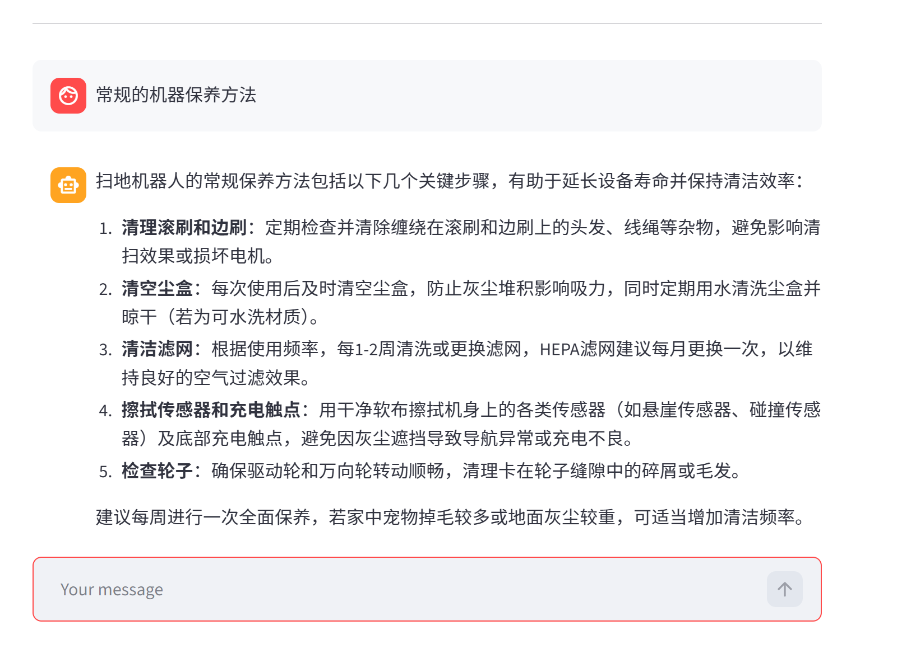
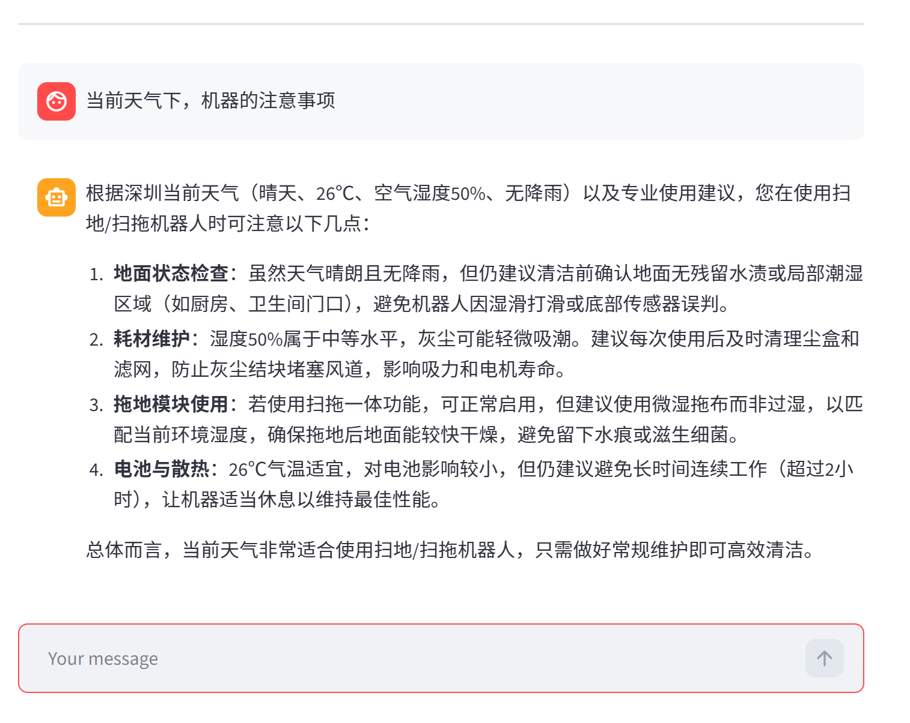
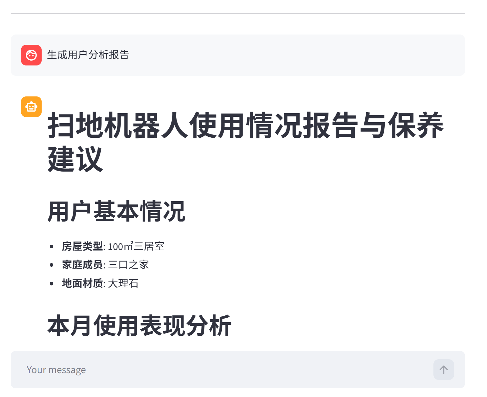

<div align="center">

# Agent Harness · 工具调用型 Agent 运行时

**基于 LangChain 1.x + LangGraph 的 Agent Runtime / Harness：工具调用、上下文、权限、记忆与评测，以扫地机器人客服为验证场景**

[](https://www.python.org/)
&nbsp;
[](https://www.langchain.com/)
&nbsp;
[](https://github.com/langchain-ai/langgraph)
&nbsp;
[](https://www.trychroma.com/)
&nbsp;
[](https://streamlit.io/)
&nbsp;
[](./LICENSE)

</div>

---

## 项目简介

本项目是基础项目 **KnowledgeBase-RAG-LLM-System** 的 Agent 演进版，定位是一个**带评测的 Agent Harness**：

- **基础项目**负责 RAG 底座：四格式文档解析、按类型切片、MD5 去重、Chroma 持久化、纯向量 / 混合检索对比；
- **本项目**负责把裸模型包装成可运行、可约束、可评测的 Agent：ReAct 循环、7 个工具注册与调度、参数校验与错误重注入、意图路由、上下文压缩、PII 脱敏、HITL 审批、多轮记忆、步数与工具调用上限；
- **客服只是验证场景**：框架与业务通过 `Scenario` 注册机制解耦，换业务只需新增场景，不需要改运行时。

系统能根据用户意图自动判断任务类型（知识问答 / 报告生成），调用合适的工具和知识库完成推理；同时内置 BFCL / τ²-bench / RAG 评测与失败集，能定位 Agent 在哪一层坏掉。

## 框架与业务场景分离

项目已把「Agent 框架」和「预设业务场景」拆开：

```text
agent/framework.py          # 通用 ReAct 运行时：create_agent + 中间件 + 流式输出
agent/contracts.py          # Scenario 契约：模型 / 提示词 / 工具 / 中间件 / context / 测试用例
scenarios/registry.py       # 场景注册表
scenarios/robot_vacuum/     # 预设业务场景：7 个工具 + 提示词 + 中间件 + cases.jsonl
interfaces/react_agent.py   # 兼容层：默认加载 robot_vacuum，保持原 API
test_entry.py               # 统一测试入口
quality/agent_eval.py       # 行为层评测：FrameworkAgent 跑场景 cases
```

- 框架层**不 import 任何业务工具**；
- 新增场景只需在 `scenarios/<name>/` 实现 `build_scenario()` 并在 `registry.py` 注册；
- `react_agent.py`、`app.py`、`interfaces/examples/demo_agent_interfaces.py` 的原有用法不变。

## 测试入口

```bash
python test_entry.py --list          # 列出场景和用例
python test_entry.py --all           # 跑全部用例
python test_entry.py --case agent-rag-001
python test_entry.py --interactive   # 交互式对话
python test_entry.py --all --judge   # 加 LLM-as-judge
python test_entry.py workflow --list # LangGraph 工作流
python test_entry.py workflow --run rag_qa --dry-run
```

报告输出到 `outputs/agent/`。

## RAG / LLM 评测

`evals/` 保存数据集，`quality/` 保存评测代码，报告写到 `outputs/`。
能力层（RAG 检索/生成、RGB/MultiHop）走 `FrameworkAgent.invoke_tool`，
行为层（13 条用例）走 `FrameworkAgent.invoke`：

```bash
python -m quality.runner agent --limit 2          # 行为层
python -m quality.runner rag retrieval --limit 5  # 能力层：检索
python -m quality.runner rag generation --limit 5 # 能力层：生成
python -m quality.runner public --rgb-limit 2 --skip-multihop
python -m quality.runner bfcl --simple 2 --irrelevance 2

# 兼容旧入口
python test_entry.py rag retrieval
python test_entry.py rag generation
python test_entry.py rag judge
python test_entry.py benchmark public
```

数据在 `evals/datasets/`（42 条业务集 + RGB 20 条 + MultiHop-RAG 12 条），
报告输出到 `outputs/rag/`。详见 [evals/README.md](./evals/README.md)。

### 当前评测结果（抽样，非官方完整分数）

| 评测 | 规模 | 指标 | 结果 |
|:---|:---:|:---|:---|
| BFCL v4（工具调用） | 200 | 函数选择 / 参数 exact / 无关请求不调用 | 100/100 · 89/100 · 80/100 |
| τ²-bench retail（多轮工具 + 政策） | 20 | Pass^1 / DB 状态 | 0.90 · 19/20 |
| 自建 RAG 业务集 | 42 | 总通过 / 拒答准确 | 38/42 · 10/10 |
| Agent 行为回归 | 13 | 通过率 | 10–12/13（工具类 13/13；RAG 覆盖受生成波动影响） |

> BFCL 为 v4 抽样；τ²-bench 的 NL assertion judge 使用 DeepSeek 替代默认 OpenAI judge，
> 不是官方评分口径。失败案例统一归档在 `evals/failures/`。
> Agent 回归为单次运行，生成有波动；`agent-rag-006` 是已知的覆盖判定争议案例。

## Harness 能力补全（参考 learn-claude-code）

> Agent 优化方向的持续整理见 [docs/design/agent-optimization-landscape.md](./docs/design/agent-optimization-landscape.md)（16 个方向 + JD 映射 + 优先级 backlog）。
> 简历项目叙事见 [docs/interview/resume-project-narrative.md](./docs/interview/resume-project-narrative.md)（2 分钟稿 + 简历 bullet + 追问清单 + 半周计划）。
> 公开 Agent 基准方案见 [docs/benchmarks/public-benchmark-plan.md](./docs/benchmarks/public-benchmark-plan.md)（τ²-bench 为主、BFCL 为辅，Agent-first）。

用 LangChain 1.x 内置中间件补齐了 Harness 层能力，业务层不用重复实现：

| learn-claude-code | LangChain 封装 | 本项目落点 |
|:---|:---|:---|
| s03 Permission | `HumanInTheLoopMiddleware` | `reset_device` 高风险工具；模型可能先自拒答，审批作为第二层保护；`tests/demos/hitl_demo.py` |
| s05 Todo Write | `TodoListMiddleware` | 自动注入 `write_todos` 工具 |
| s08 Context Compact | `SummarizationMiddleware` | 30 条消息触发，保留最近 12 条 |
| s09 Memory | `InMemorySaver` / `SqliteSaver` + `thread_id` | 同一 thread 保留多轮历史；SQLite 跨实例/重启保留；`tests/demos/memory_demo.py`、`tests/persistent_memory_demo.py` |
| s11 Error Recovery | `ToolRetry` / `ModelRetry` / `ModelFallback` / `ToolError` | 工具与模型重试、异常回注（fallback 可配置） |
| s03 PII | `PIIMiddleware` | email / credit_card / ip 脱敏 |
| 工具循环控制 | `ToolCallLimitMiddleware` | 单次 run 最多 12 次工具调用 |
| 工具权限 | `ToolPermissionMiddleware`（自研） | `tool_policy` 的 allow / deny / risk_levels；deny 直接返回 error ToolMessage |
| 工具超时 | `ToolTimeoutMiddleware`（自研） | 默认 30s，`rag_summarize` 60s；超时返回 error ToolMessage |
| 可观测性 | `TraceCallbackHandler`（自研） | 模型/工具/token/耗时写 `logs/traces/*.jsonl`；`python test_entry.py trace --last 10` |
| s12 Task System | `TodoListMiddleware`（部分） | 任务清单；完整依赖图未实现 |
| s06 Subagent / s07 Skill / s13-14 后台任务 / s18 Worktree / s19 MCP | 暂未引入 | 需要独立运行时或外部服务，当前客服场景优先级低 |

配置入口在 `agent/contracts.py` 的 `Scenario`：`high_risk_tools`、`fallback_model`、
`enable_todo`、`enable_summarization`、`tool_call_limit`、`pii_types`、`checkpoint`、
`checkpoint_backend`、`checkpoint_path`、`tool_policy`、`tool_timeout_seconds`、`tool_timeouts`。

```bash
python tests/demos/hitl_demo.py --decision reject
python tests/demos/memory_demo.py
python tests/persistent_memory_demo.py   # 两个实例共享 SQLite checkpoint
python test_entry.py trace --last 10     # 查看最近 trace
python test_entry.py workflow --list
python test_entry.py workflow --run rag_qa --dry-run
```

## 可观测性与持久化

### 1. 本地 trace（不依赖 LangSmith）

`observability/tracer.py` 实现 `TraceCallbackHandler`，作为 callback 挂到
`agent.invoke/stream` 的 config 上，记录：

- 每次模型调用的模型名、耗时、prompt/completion/total tokens；
- 每次工具调用的工具名、参数、耗时、状态；
- 一次 run 的 `run_end` 汇总：模型/工具调用次数、token 总量、总耗时、cost 估算。

事件追加写入 `logs/traces/trace_YYYYMMDD.jsonl`，一行一个事件：

```bash
python test_entry.py trace --last 10
python test_entry.py trace --trace-id run-xxxx
```

token 直接取 LangChain 的 `usage_metadata` / OpenAI 的 `token_usage`；
cost 只有在 `config/observability.yml` 配置了价格时才计算，避免写死不准的价格。

### 2. SQLite 会话持久化

`agent/checkpoint.py` 提供 `build_checkpointer(backend, path)`：

- `memory`：`InMemorySaver`，进程内记忆，重启即丢；
- `sqlite`：`SqliteSaver` 写 `data/runtime/agent_checkpoints.sqlite`，跨实例/重启保留。

`scenarios/robot_vacuum/config/agent.yml` 的 `checkpoint_backend` / `checkpoint_path` 控制。
`tests/persistent_memory_demo.py` 用两个独立的 `ReactAgent` 实例验证：
第一个实例说“我叫小明”，销毁后第二个实例用同一个 `thread_id` 仍能回答。

### 3. 工具权限与超时

- `ToolPermissionMiddleware`：按 `tool_policy` 做 allow / deny；deny 不执行工具，
  直接返回 `status="error"` 的 ToolMessage，模型看到后改路；
- `ToolTimeoutMiddleware`：默认 30s，`rag_summarize` 60s；同步链路放线程池，
  异步链路用 `asyncio.wait_for`，超时返回 error ToolMessage。
- 顺序：权限（最外层）→ 业务中间件 → HITL → 超时 → `ToolError` → `ToolRetry` → 工具调用上限 → 工具。
  权限在最外层，deny 的工具不会进入审批/执行；超时在 HITL 内层，人工审批时间不计入工具超时；
  `ToolError` 在 `ToolRetry` 外层，重试耗尽后才把异常转成 error ToolMessage。

## 效果展示

<div align="center">



*图1. 普通问答 — RAG 检索知识库回复*

&nbsp;



*图2. Agent 工具调用 — 实时展示推理与工具执行链路*

&nbsp;



*图3. 工具调用详情 — 多步推理与中间结果可视化*

</div>

## 技术架构

```text
用户输入 (Streamlit)
      │
      ▼
┌────────────────────────────────────────────────────┐
│                    ReAct Agent                     │
│                                                    │
│   Thought ──→ Action ──→ Observation ──→ Thought   │
│      │           │             │                   │
│      │           ▼             │                   │
│      │      工具调用           │                   │
│      │   （参数校验/异常兜底）  │                   │
│      └─────────────────────────┘                   │
│                                                    │
│   Middleware：                                     │
│   intent_router → 动态提示词（qa / report）         │
│   validate_tool_args → 非法参数 error 重注入        │
│   limit_steps → 最大模型调用步数限制                │
│   monitor_tool / log_before_model → 全链路日志      │
└───────────────┬──────────────────────┬─────────────┘
                │                      │
                ▼                      ▼
      ┌──────────────────┐    ┌──────────────────┐
      │   RAG 检索增强    │    │    业务工具       │
      │  向量 + BM25 混合  │    │ 天气/定位/用户ID   │
      │  Chroma 持久化     │    │ 月份/外部使用记录  │
      └──────────────────┘    └──────────────────┘
```

### 核心特性

| 特性 | 说明 |
|---|---|
| **ReAct 范式** | Thought → Action → Observation 循环，Agent 自主推理并决定调用哪个工具 |
| **RAG 检索增强** | 支持 **txt / pdf / docx / md** 四种格式；按文件类型差异化切片；MD5 去重（带来源）+ 内容更新替换；Chroma 本地持久化 |
| **混合检索** | 纯向量 vs 向量 + BM25 关键词兜底（jieba 分词 + 加权 RRF 融合），Top-K 可配置 |
| **7 个工具** | `rag_summarize` / `get_weather` / `get_user_location` / `get_user_id` / `get_current_month` / `fetch_external_data` / `reset_device`（高风险，走 HITL） |
| **参数校验中间件** | 拦截非法工具参数（如 user_id 非数字、month 格式错误），以 `status="error"` 的 ToolMessage 重注入 Agent 循环，促使模型修正后重新规划 |
| **意图路由 + 切换日志** | `agent.yml` 关键词规则识别「报告生成 / 普通问答」，首轮模型调用前切换提示词；切换记录写入独立日志，便于 badcase 复盘 |
| **最大步数限制** | `max_model_calls` 控制 ReAct 循环上限，超限返回中文兜底回复，避免死循环和 token 浪费 |
| **YAML 全面驱动** | 模型、Top-K、混合权重、检索模式、按类型切片参数、提示词模板、意图关键词、步数上限均可配置 |
| **流式对话界面** | Streamlit 构建，支持流式输出、历史消息留存、工具调用过程可见 |

## 技术栈

| 层级 | 技术 |
|---|---|
| LLM / Embedding | DeepSeek `deepseek-chat` / BAAI `bge-small-zh-v1.5`（本地 CPU） |
| Agent 框架 | LangChain 1.4.2 + LangGraph 1.2.12 |
| 向量数据库 | Chroma 1.5.9（本地持久化） |
| 检索 | 向量检索 + 手写 BM25 + 加权 RRF（`langchain-classic` EnsembleRetriever） |
| 文档处理 | pypdf / python-docx / RecursiveCharacterTextSplitter |
| 中文分词 | jieba（未安装时自动降级为 bigram） |
| 前端 | Streamlit 1.40 |
| 配置 | YAML 驱动（Agent / RAG / Chroma / Prompts） |

## 快速开始

### 环境要求

- **Python** ≥ 3.10
- **DeepSeek API Key**（[platform.deepseek.com](https://platform.deepseek.com/) 申请）
- 本地 Embedding 模型约 100MB，首次运行需下载

### 1. 克隆仓库

```bash
git clone https://github.com/Stormlittleliu/agent-harness.git
cd agent-harness
```

### 2. 安装依赖

```bash
pip install -r requirements.txt
```

### 3. 配置 API Key

参考 `.env.example`，设置 DeepSeek API Key：

```bash
# Linux / macOS
export DEEPSEEK_API_KEY="your-api-key"

# Windows (CMD)
set DEEPSEEK_API_KEY=your-api-key
```

> 也可以在项目根目录创建 `.env` 文件，写入 `DEEPSEEK_API_KEY=your-api-key`（`model/factory.py` 会自动加载）。

### 4. 下载本地 Embedding 模型（首次运行）

```bash
python -c "from modelscope import snapshot_download; snapshot_download('BAAI/bge-small-zh-v1.5', local_dir='models/bge-small-zh-v1.5')"
```

模型约 100MB，CPU 即可运行；`config/rag.yml` 的 `embedding_model_name` 已指向该目录。

### 5. 初始化知识库（首次运行）

```bash
python -c "from tools.rag.vector_store import VectorStoreService; VectorStoreService().load_document()"
```

该命令会读取 `data/knowledge/` 下所有允许类型的文档，解析、切片并分批写入 Chroma。重复执行会自动跳过未变化的文件；文件内容变化时会替换旧分块。

### 6. 启动应用

```bash
streamlit run app.py
```

浏览器自动打开 http://localhost:8501

### 验证运行

启动后在聊天框输入以下测试问题：

- *扫地机器人有哪些主要功能？*（RAG 知识库问答）
- *如果机器人无法正常回充，该如何处理？*（故障排查 + 工具调用）
- *给我生成我的使用报告*（意图路由切换报告提示词 + 多工具组合）

## 项目结构

```text
agent-harness/
│
├── agent/                          # L1 Harness
│   ├── contracts.py                #   Scenario / Tool / Workflow 契约
│   ├── framework.py                #   通用 Runtime + 中间件装配
│   ├── checkpoint.py               #   memory / sqlite checkpointer 工厂
│   ├── workflow.py                 #   通用 LangGraph 工作流运行时
│   └── middleware/
│       ├── generic.py              #   日志/参数校验/步数限制
│       └── policy.py               #   工具权限 + 超时
│
├── tools/                          # L2 能力层（业务 / RAG）
│   ├── business/
│   │   ├── constants.py            #   user_ids / month_arr
│   │   └── tools.py                #   6 个业务工具（天气/定位/用户/月份/记录/重置）
│   └── rag/
│       ├── embedding.py            #   本地 BGE / DashScope
│       ├── vector_store.py         #   Chroma · 四格式入库 · MD5 去重
│       ├── retrievers.py           #   纯向量 / BM25 / 混合检索
│       ├── service.py              #   RAG 检索 → LLM 总结
│       └── tools.py                #   rag_retrieve / rag_summarize
│
├── scenarios/                      # L3 业务场景（组合根）
│   └── robot_vacuum/
│       ├── scenario.py             #   工具 + 提示词 + 中间件 + 测试用例
│       ├── graph.py                #   该场景的 LangGraph 工作流
│       ├── middleware.py           #   意图路由 / 提示词切换
│       ├── validators.py           #   工具参数校验规则
│       ├── cases.jsonl
│       └── config/                 #   场景级 agent.yml / prompts.yml
│
├── interfaces/                     # L4 接口层
│   ├── react_agent.py              #   兼容门面：按场景构建 Agent
│   ├── cli.py                      #   test_entry 的实现
│   ├── streamlit_app.py            #   Streamlit 应用
│   └── examples/
│       └── demo_agent_interfaces.py
│
├── quality/                        # L5 质量层
│   ├── runner.py                   #   统一 CLI
│   ├── datasets.py / metrics.py    #   数据加载 / 指标
│   ├── paths.py                    #   datasets / outputs 路径
│   ├── rag_harness.py              #   评测 Scenario 装配
│   ├── agent_eval.py               #   行为层：FrameworkAgent
│   ├── rag_eval.py                 #   能力层：invoke_tool
│   ├── public.py                   #   RGB / MultiHop
│   ├── judge.py / rag_judge.py     #   LLM judge
│   ├── bfcl.py                     #   BFCL 外部适配器
│   └── failures.py                 #   失败集
│
├── model/factory.py                # 聊天模型工厂（DeepSeek / DashScope）
├── utils/                          # 配置、文件解析、日志、路径、提示词加载
│
├── observability/                  # 本地可观测性
│   ├── tracer.py                   #   callback → JSONL（模型/工具/token/耗时）
│   └── trace_report.py             #   查看最近 trace
│
├── config/                         # 全局能力配置
│   ├── chroma.yml / rag.yml
│   ├── rag_prompts.yml             #   RAG 总结提示词
│   └── observability.yml           #   trace 目录 / 可选价格
│
├── data/
│   ├── knowledge/                  #   知识库文档（txt/pdf）
│   ├── external/                   #   外部使用记录 CSV
│   ├── runtime/                    #   Chroma / md5（gitignore）
│   └── backups/                    #   旧向量库备份（gitignore）
│
├── evals/                          # 评测数据
│   ├── datasets/                   #   业务集 + 公开基准抽样
│   └── failures/                   #   失败案例归档
│
├── outputs/                        # L6 运行产物（gitignore）
│   ├── agent/ rag/ public/ bfcl/
│   └── traces/
│
├── tests/                          # 演示
│   ├── persistent_memory_demo.py   #   跨实例 SQLite 记忆
│   └── demos/                      #   HITL / Memory 演示
│
├── docs/
│   ├── design/                     #   优化方向全景
│   ├── interview/                  #   简历叙事、面试周计划
│   ├── benchmarks/                 #   公开基准方案
│   └── assets/                     #   截图
│
├── interfaces/examples/demo_agent_interfaces.py  # 主循环接口演示
├── app.py                          # 兼容入口：streamlit run app.py
├── test_entry.py                   # 兼容入口：python test_entry.py ...
├── requirements.txt
└── README.md
```

## 中间件与 Agent 能力

### 工具参数校验（重注入闭环）

`validate_tool_args` 在工具真正执行前校验参数：

| 工具 | 校验规则 |
|---|---|
| `fetch_external_data` | `user_id` 必须为纯数字且在 1001~1010；`month` 必须为 `YYYY-MM` 且在 2025-01~2025-12 |
| `get_weather` | `city` 非空且长度 ≤ 20 |
| `rag_summarize` | `query` 非空 |
| `get_user_id` / `get_user_location` / `get_current_month` | 不接受任何参数 |

非法调用不会执行工具，中间件直接返回 `ToolMessage(status="error")`。模型在下一轮看到这条错误观察，可以修正参数并重新调用，而不是让整个 run 崩溃。

### 意图路由与提示词切换

1. 一次 run 开始时，`intent_router`（`before_agent` 钩子）读取用户问题；
2. 按 `scenarios/robot_vacuum/config/agent.yml` 中的 `intent.report_keywords` 做关键词匹配；
3. 命中 → `intent=report`，否则 `intent=qa`，写入 `runtime.context`；
4. 每次模型调用前，`report_prompt_switch`（`wrap_model_call` 钩子）按意图返回报告 / 普通问答提示词。

切换日志单独落盘：`logs/intent_router_YYYYMMDD.log`，记录完整问题、意图和命中的关键词。发现漏判时，直接在 `agent.yml` 里补充关键词即可完成 badcase 闭环，无需改代码。

### 最大步数限制

`limit_steps`（`before_model` 钩子，`can_jump_to=["end"]`）统计当前 run 中 AIMessage 的数量。达到 `max_model_calls` 时直接结束循环并返回中文兜底回复：

> 抱歉，该问题的处理步骤已超过上限（8 步），我暂时无法给出可靠回答。请补充更具体的信息后重试。

> 中间件同时实现了同步与异步钩子：`invoke / stream` 和 `ainvoke / astream_events` 两条调用链都能正常执行参数校验、意图路由和步数限制。

## 配置说明

项目通过全局 `config/` 和场景级 `scenarios/<name>/config/` 管理配置：

| 文件 | 配置项 | 说明 |
|---|---|---|
| `config/rag.yml` | `chat_provider` / `chat_model_name` | 聊天模型（默认 deepseek / deepseek-chat） |
| | `embedding_provider` / `embedding_model_name` | Embedding（默认 local / BGE 本地模型） |
| | `retrieval_k` | 检索返回条数（Top-K，默认 4） |
| | `retrieval_mode` | `vector` 纯向量 / `hybrid` 向量+BM25（默认 hybrid） |
| | `hybrid_weights` | 混合检索两路权重 |
| | `bm25_tokenizer` | `jieba` / `bigram` / `char` |
| `config/chroma.yml` | `collection_name` / `persist_directory` | 集合名与本地持久化目录 |
| | `data_path` / `md5_hex_store` | 文档目录与 MD5 记录文件 |
| | `allow_file_types` | 允许入库的格式（txt/pdf/docx/md） |
| | `max_split_char_number` | 短文本整段入库阈值 |
| | `chunking` | 按文件类型配置 `chunk_size` / `chunk_overlap` / `separators` |
| `config/rag_prompts.yml` | `rag_summarize_prompt` | RAG 总结 Prompt（含 `{input}` / `{context}`） |
| `config/observability.yml` | `trace_dir` | trace 输出目录 |
| | `pricing` | 可选：按模型配置每百万 token 价格，不填只统计 token |
| `scenarios/robot_vacuum/config/prompts.yml` | `main_prompt` | 普通问答 System Prompt |
| | `report_prompt` | 报告生成 System Prompt |
| `scenarios/robot_vacuum/config/agent.yml` | `external_data_path` | 外部使用记录 CSV 路径 |
| | `max_model_calls` | 最大模型调用步数 |
| | `intent.report_keywords` | 报告意图关键词列表 |
| | `tool_policy` | 工具 allow / deny / require_approval / risk_levels |
| | `tool_timeout_seconds` / `tool_timeouts` | 工具超时（默认 30s，RAG 60s） |
| | `checkpoint_backend` / `checkpoint_path` | `memory` / `sqlite` 会话持久化 |

> 修改配置后重启应用即可生效。提示词按层级拆分：RAG 能力提示词在 `config/rag_prompts.yml`，场景提示词在 `scenarios/<name>/config/prompts.yml`。

首次运行只需确保 **DeepSeek API Key 已设置**、本地 Embedding 模型已下载，且 `data/knowledge/` 目录下有知识库文档即可。

## 与基础项目的演进关系

```text
KnowledgeBase-RAG-LLM-System（RAG 底座）
  ├─ 四格式解析 / 按类型切片
  ├─ MD5 去重 + 更新替换 + Chroma 持久化
  ├─ 纯向量 vs 混合检索对比
  └─ YAML 配置化 + Streamlit 多页面
                │
                ▼  复用并保持一致
Agent Harness（本项目）
  ├─ 同样的解析 / 切片 / 检索底座
  ├─ ReAct 循环 + 7 个工具
  ├─ 工具参数校验（error 重注入）
  ├─ 意图路由 + 动态提示词 + 切换日志
  └─ 最大步数限制
```

两个项目共用同一套配置语义（模型、Top-K、混合权重、切片参数等），便于对照学习「RAG 问答」如何演进为「RAG + Agent」。后续可继续扩展的方向：长期记忆、MCP / Skills、线上评测与 A/B、把公共底座抽取为共享包。

## License

MIT © [lhh737](https://github.com/lhh737)
