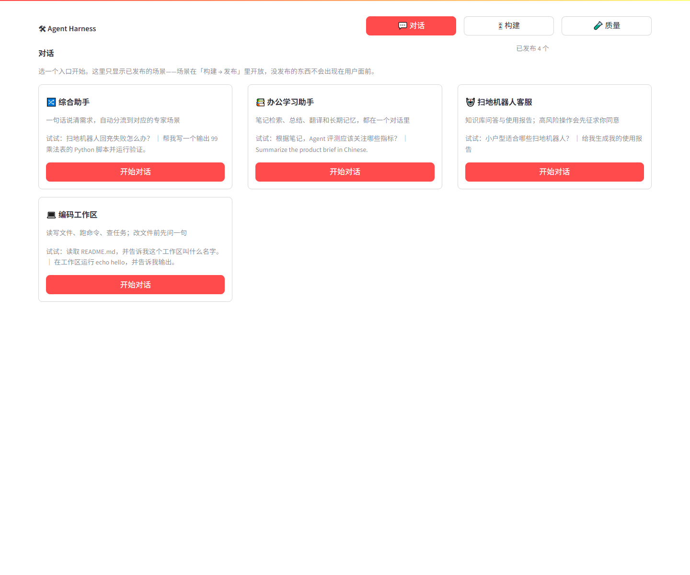
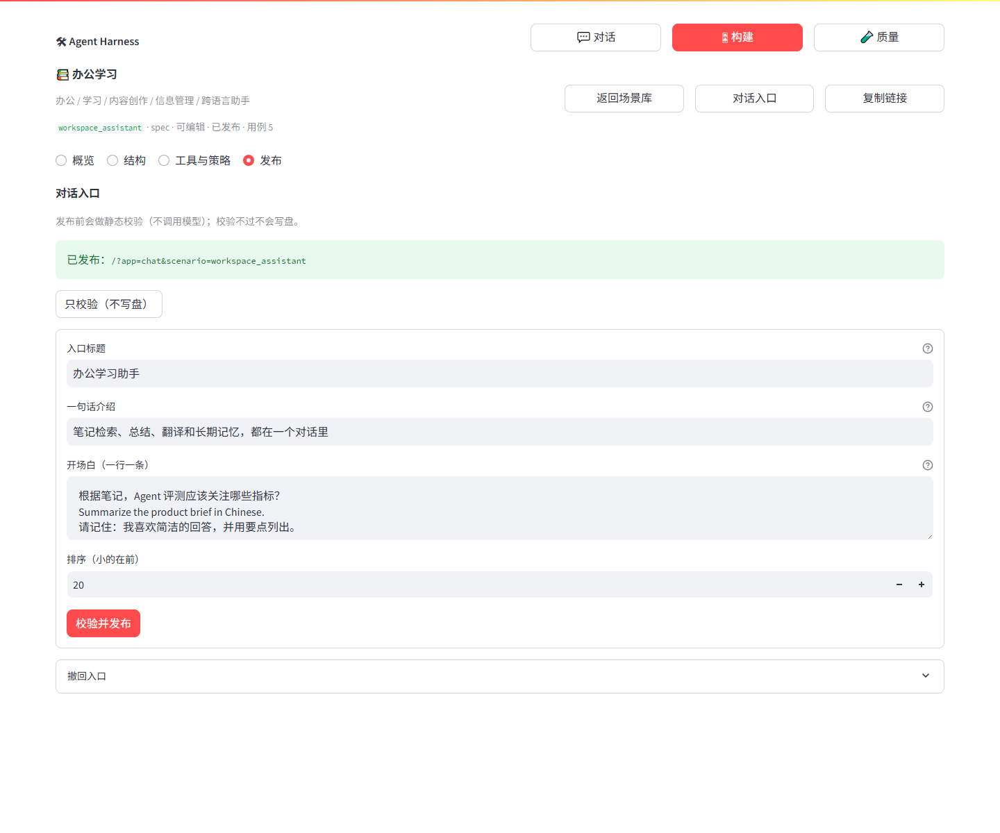

# 控制台：三个产品（对话 / 构建 / 质量）

> 结论先写：控制台不再是"一个侧边栏 + 8 个平级页面 + 一个全局场景选择器"，
> 而是三个工作对象不同的产品：**对话**（一次会话）、**构建**（一个场景）、
> **质量**（一次运行）。场景由路由携带，页面不再共享"当前场景"这种全局变量。





## 1. 为什么旧结构一定会串台

旧实现里：

1. 场景选择器放在全局侧边栏，所有页面共享 `dashboard-scenario-name`；
2. 换场景时 `_clear_scenario_state()` 一次清掉 50 多个 key（画布草稿、评测筛选、
   表格选择、任务结果……）；
3. 8 个页面平级，但它们的"工作对象"根本不同：任务页是*一次运行*，编辑页是
   *一个场景*，评测页是*一次评测*，目录页是*一批样例*。

把不同工作对象硬塞进同一级菜单，就只能靠"换场景时把所有状态清掉"来防串台。
这不是 bug，是结构问题。

## 2. 三个产品，三种工作对象

| 产品 | URL | 工作对象 | 状态前缀 |
|---|---|---|---|
| 对话 | `/?app=chat` | 一次会话（thread） | `chat:*` |
| 构建 | `/?app=build&scenario=<name>` | 一个场景（+ 版本） | `build:*` |
| 质量 | `/?app=quality` | 一次运行（run） | `quality:*` |

对应关系：

```text
对话  /?app=chat
 ├─ 入口页          只列已发布场景；点卡片进会话
 └─ 会话页 ?scenario= 多轮对话 · 每轮展开"这次怎么答的" · HITL 审批

构建  /?app=build
 ├─ 场景库          归属 / 版本 / 用例数 / 发布状态
 └─ 场景详情 ?scenario=&tab=
     ├─ 概览        身份、示例、版本、入口链接
     ├─ 结构        画布 / 表单（同一个编辑器，场景由路由固定）
     ├─ 工具与策略   工具箱、中间件链、工作流图、对象索引
     ├─ 发布        入口信息 + 校验 + 发布 / 撤回
     └─ 运行窗口    仅 supports_runtime 的场景（coding_demo）

质量  /?app=quality
 ├─ 评测 / 复核 / 优化 / 自检 / 数据集 / 基准 / 成本 / 记录
```

两个刻意的降级：

- **"可视化分析"不做独立页面**，而是场景详情里的「工具与策略」页签。分析的对象
  就是正在编辑的场景；独立页会让用户再选一次场景，正是旧结构串台的病根。
- **"任务执行"拆成两件事**：用户面是多轮对话（`chat`），开发面是构建页里的结构
  预览 / 试跑。两个东西混在一个"任务执行"页里，才需要全局场景选择器。

## 3. 路由：query 参数，不是 `st.navigation`

为什么不用 `st.navigation`：Streamlit 1.40 的 callable 页面在 AppTest 里**拿不到
子页面元素**，`switch_page` 也只认文件路径。本仓库的界面测试全靠 AppTest，所以
路由自己解析，收敛在 `core/interfaces/console/routes.py`：

- 优先级：query 参数 > 环境变量（`AH_CONSOLE_APP` / `AH_CONSOLE_SCENARIO` /
  `AH_CONSOLE_TAB`）> 默认值；
- 深链可分享：`/?app=chat&scenario=robot_vacuum`；
- 跳转写 `session_state['console:route']` 再同步 URL（测试环境没有 URL 也不影响）；
- 以后想换成 `/chat`、`/build` 这种路径，只改 `parse()` / `link()` 两个函数。

`run()` 里只有 `set_page_config`、CSS、产品切换条和一次分发；页面内部不再有
"当前场景"这种跨产品共享的状态。

## 4. 对话入口：发布是显式动作

场景库回答"有哪些场景"，归属回答"谁说了算"，**入口回答"用户能不能用"**。
三者分开，入口数据在 `data/specs/<name>/entry.yml`：

```yaml
enabled: true
title: 扫地机器人客服
tagline: 知识库问答与使用报告；高风险操作会先征求你同意
starters:
- 小户型适合哪些扫地机器人？
- 给我生成我的使用报告
order: 30
published_hash: 4621b055707eed4d
```

规则（`core/scenarios/entry.py`）：

- **发布前静态校验，不调用模型**：spec 能读、`validate_spec` 通过、工具都在工具箱里、
  提示词块齐全、场景有描述、每个工作流节点都有中文说明；
- 校验不过抛 `EntryError`，**不写盘**，旧配置保持不变；
- 发布时写入 `published_hash`（active spec + 提示词块的结构指纹）；
  之后改结构没重新发布会显示**"有未发布改动"**，入口仍按上次发布的状态；
- 撤回只把 `enabled` 关掉，产品信息保留；
- 对话端只认 `entry.yml`，不读场景库——所以"在库里有 spec"不等于"用户能看见"。

## 5. 对话端行为

- 入口页只读 `entry.yml` + 场景库元数据，**不加载 Agent**，打开很快；
- 每个入口一条独立 thread（`chat:thread:<name>`），换入口 = 换会话，
  不会把上一个场景的记忆 / 审批状态带过来；
- 每轮回答下可展开「这次怎么答的」：调用链（模型 / 工具步骤 + 所属节点 + 悬停说明）
  与逐条 trace；
- 高风险工具触发 HITL 时，同一位置直接批准 / 拒绝，禁止继续发消息；
- 异常写进会话历史，刷新不丢。

## 6. 构建端布局

- 场景库：每张卡片显示 `spec/code`、已发布 / 未发布、用例数；「新建场景」保留在底部；
- 场景详情：页签 `概览 / 结构 / 工具与策略 / 发布`（`coding_demo` 多一个运行窗口）；
- **结构页签复用同一个编辑器**（`render_editor(name, embedded=True)`）：场景由路由
  固定，页面里不再出现第二个场景选择器；画布 / 表单 / 版本 / eject 都还在；
- 发布页签：标题、一句话、开场白、排序 + 只校验 + 校验并发布 + 撤回 + 可复制链接。

## 7. 质量端

第一阶段先把旧控制台的视图整体搬进来，避免功能倒退：

| 旧视图 | 新位置 |
|---|---|
| `evaluation` | 质量 → 评测 |
| `review` | 质量 → 复核 |
| `optimization` | 质量 → 优化 |
| `tests` | 质量 → 自检 |
| `catalog` | 质量 → 数据集 |
| `benchmarks` | 质量 → 基准 |
| `cost` | 质量 → 成本 |
| `history` | 质量 → 记录 |
| `architecture` | 构建 → 工具与策略 |
| `task` | 对话（多轮）/ 构建里的试跑 |
| `runtime` | 构建 → 运行窗口（仅 `coding_demo`） |

数据集的结构化改造（增删改、版本、导入导出）**还没做**，这是下一阶段的事。

## 8. 迁移阶段

| 阶段 | 内容 | 状态 |
|---|---|---|
| P0 | 新壳 `console/` + 路由 + 三个产品 | 已完成 |
| P1 | 对话端 + `entry.yml` 发布 + 发布页签 | 已完成 |
| P2 | 场景库 → 详情页签；删全局场景选择器与 `_clear_scenario_state` | 已完成（编辑器 `embedded`） |
| P3 | 质量台归位（先接现有视图，数据集后做） | 视图已归位，数据集待做 |
| P4 | 文档、截图、旧入口 shim | 文档已更新；`agent_dashboard.py` 保留为转发 shim |

## 9. 验证

- 全量测试 **282 passed**（新增路由 / 发布 / 控制台冒烟 / 嵌入编辑器，共 20 条）；
- AppTest 覆盖：默认落在对话入口、入口只列已发布、会话历史渲染、开场白、已关闭入口
  的兜底、场景库全量、详情页签、发布表单、质量页各视图、切入口保留其他 thread；
- 真实链路手测：`workspace_assistant` 连续两轮对话，第二轮能答出"杭州"（thread 复用
  生效），每轮都有「这次怎么答的」展开项。

## 10. 已知限制 / 非目标

- 同一次浏览器会话里，**手改 URL 的 query 参数不会切换页面**（路由以 session 为准，
  刷新后才会按 URL 解析）；跨标签页本来就是不同 session，不受影响；
- 对话历史只存在 session_state，刷新页面会丢；持久化（thread 落盘、会话列表）
  是下一阶段；
- 不做多用户 / 鉴权；不做生产级并发；
- 数据集 CRUD、质量台的信息架构改造仍在 P3 之后。
