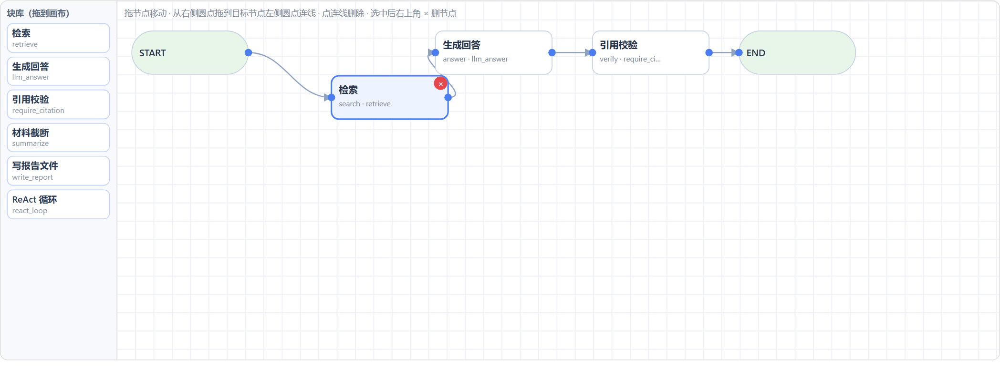

# 控制台里的场景编辑器

> 落地日期：2026-11-04。代码：`core/interfaces/dashboard/editor.py` +
> `core/interfaces/dashboard/canvas/`（画布组件）+ `core/scenarios/spec_edit.py`
> + `core/scenarios/generic.py`。
> 视图名「🎛 场景编辑」，控制台里直接可用，默认就是可视化画布。



---

## 0. 先看这张图

左边是块库（6 个已注册的块），中间是画布：START / END 是固定的出入口，
每个节点标着「中文名 + id · 块名」，右侧圆点拖到下一个节点左侧圆点就连一条边，
点连线删除，选中节点后右上角出现 × 删除。节点位置会记住（`data/runtime/spec_layout/`），
"重新自动排版"能回到按层自动布局。

---

## 1. 它解决什么

没有它的时候，加一个场景要写 `core/scenarios/<name>/scenario.py`；
有了 spec 层之后，这个文件可以只是三行（读 spec → 构建），但**写 spec 仍然要手改 JSON**。
编辑器把"手改 JSON"换成表单 + 校验 + 编译预览，让"场景即数据"这件事真的能演示。

判据只有一条：**不改代码，能不能在界面上加一个场景并且它真的能跑。**

## 2. 数据流

```
表单/表格          draft (dict, 会话内)                    磁盘
────────         ─────────────────────                   ───────────────────────────
基本信息  ──┐                                               data/specs/<name>/vN.json
节点/参数 ──┼──▶  draft ──spec_from_draft──▶ ScenarioSpec ──▶ （校验 + 编译通过才写）
边       ──┤                    │                          data/specs/<name>/active.json
策略覆盖 ──┘                    └──build_workflows(stub)──▶ 预览 DOT（不落盘）
```

- **draft** 就是 `spec_to_dict(spec)` 的形状，所以"载入已有 spec"和"新建"走同一条路径；
- **保存** = `draft_errors()`（结构 + 必填）→ `build_workflows()`（真编译一遍）→ `save_spec()`（原子写 vN + 移动 active）；
- **编译不过不写盘**：错误直接显示在预览区，磁盘上不会留下半成品版本；
- 保存后 `load_agent` / `_graphs` 缓存被清掉，刷新页面就能用新版本。

## 3. 边界（刻意的）

| 能 | 不能 |
|---|---|
| 在画布上拖块、连线、移动、删节点/删边 | 在画布上写代码、内联表达式 |
| 增删工作流，用表单逐个改节点 | 引用工具池之外的工具 |
| 引用已注册的块，参数按 `ParamSpec` 渲染 | 改中间件实现、改执行顺序 |
| 显式开关中间件策略（关闭必须写理由） | 自动重连（删节点后悬空边就是错误） |
| 保存新版本、载入历史版本、下载 JSON | 从 code 回到 spec |
| 单向 `eject` 转代码 | 画布里改节点参数（参数在面板里） |

拖动式画布**做了**（见下节），但"拖动"本身不是重点：难点是"连线之后运行时策略和评测还成立"。
画布再顺手，也只是把同一份 spec 换个输入方式；真正拦住错误的是编译期校验和归属守卫。

## 3.5 画布：块组合 + 拖拽

- 前端：`core/interfaces/dashboard/canvas/index.html`，**单文件、无 npm、无 CDN**，
  自带一个很小的拖拽图编辑器（SVG + 原生事件），通过 Streamlit 静态组件协议收发 JSON；
- 后端：`core/interfaces/dashboard/canvas.py` 只做 `declare_component` + 传参；
- 交换格式：
  ```
  后端 -> 前端  {nodes:[{id, fn, label, x, y, kind?}], edges:[[from,to]], blocks, errors, selected}
  前端 -> 后端  {nodes:[{id, fn, x, y}], edges, anchors:{__start__:[x,y], __end__:[x,y]}, selected, version}
  ```
- **画布只改拓扑和位置**：`merge_canvas` 把回传当不可信输入——未知块、重复 id、
  悬空边、空节点列表一律丢掉；节点参数只在"块没变"时保留，换块就重置为块默认值；
- 位置不进 spec（schema 拒绝多余字段），放 `data/runtime/spec_layout/<name>.json`，
  这个目录已被 `.gitignore` 覆盖；
- 校验错误会把**出错节点标红**（`bad_node_ids` 从错误文本里认出节点 id），
  所以"悬空 / 不可达"在画布上就能看见，而不是只在一行红字里。

**为什么不用现成的 React Flow / streamlit-flow-component**：要 npm 构建或额外依赖，
面试前引入一个装不上的依赖风险太高；这个页面只需要 30 行协议 + 300 行原生 JS，
离线可跑，坏了也只是画布不可用，表单模式还在。

## 4. 两种场景来源

1. **已有 spec 场景**（目前是 `flow_demo`）：编辑器直接改它的 `data/specs/flow_demo/v*.json`；
2. **界面新建**：只在 `data/specs/<name>/` 下写 spec，构建走
   `core/scenarios/generic.py` 的通用构建器——工具来自固定池（笔记检索 / 读写 / 记忆 / 翻译 / 总结），
   所以"新建 → 保存 → 立刻能在子场景下拉框里选中并跑"是真的，不需要再写 `scenario.py`。
   要别的工具就先 eject 再写代码，这是刻意留的边界，避免 spec 长成第二套工具注册表。

`core/scenarios/registry.py` 的 `list_scenarios()` 会把两类场景并起来：
手写构建器优先，其余按 `data/specs/*/active.json` 动态发现（已 eject 的不算）。

## 5. 和归属守卫的关系

编辑器**自己不做归属判断**，它读 `ownership.status()`：

- `owner=code` → 整页只读，显示历史 spec 与"改代码"的提示；
- `owner=spec` 但 `hash_match=false` → 报错，要求先 `eject`；
- 可编辑 → 正常渲染。

所以"界面能改"和"构建时认谁"是同一个状态机，不是两套开关。
`eject` 按钮带三重确认（写原因 + 勾选 + 已存在代码目录）：没有代码目录的纯 spec 场景不允许 eject，
否则它会从场景列表里消失。

## 6. 演示脚本（90 秒）

1. 选中 `flow_demo`，画布上指着 START → 检索 → 生成回答 → 引用校验 → END；
2. 从块库把「材料截断（summarize）」拖进来，把 检索 → 材料截断 → 生成回答 连起来；
3. 点「只校验」——**先故意把它的出边删掉**，看节点被标红、报 "从 START 不可达 / 走不到 END"（证明校验是真的）；
4. 补上边，点「保存为新版本」→ 出现 v2；
5. 去「任务执行」跑一句问题，调用链上每一步都标着它属于哪个节点。

第 3 步是重点：**能拦住错误，比能连线更值钱。**
