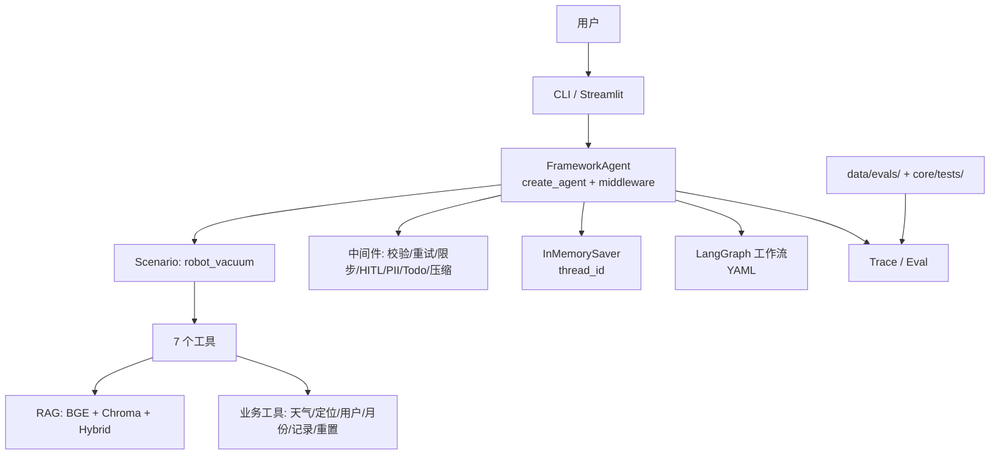

# 简历项目叙事（半周版）

> **历史版本（2026-10-31）**：数字和叙事已过时。2026-11-02 起以
> `docs/interview/interview-pack-2026-11-04.md`（简历文案）和
> `docs/interview/jd-results-2026-11-04.md`（数字口径）为准。
>
> **2026-11-04 叙事修订**：第 1、2 节按真实起点重写；删除“工具一多就失控”
> 这类没有出处的因果。第 3 节以后保留为历史素材，数字以 `jd-results` 为准。

> **目标**：用 3–4 天，把现有项目整理成一段 **2 分钟能讲清、经得起追问** 的简历叙事。
> **项目**：Agent 产品工作台（多场景 Agent 运行时与评测闭环）
> **当前状态（2026-11-04）**：9 个 spec 场景、365 个确定性测试；workspace 3-trial 5/5、planning policy 12/12、outcome 12/12。
> **原则**：只讲真实做过的；小样本就说小样本；不把自建评测说成线上指标。
> **岗位重心**：Agent 开发 / AI 应用工程师。**评测与产品场景为主证据**，公开基准只作补充；RAG 是工具，不是项目身份。

---

## 1. 一句话定位

> **一个带评测的多场景 Agent 产品工作台：从算法/微调转 AI 应用，先跑通开源 RAG，再把 RAG 收成 Agent 工具；跟着 Claude Code 解构项目补能力，臃肿后做分层/契约，发现功能难以验证后转向真实评测集。**

不要介绍成"我用 LangChain 做了一个聊天机器人"——那是 API wrapper 的叙事。

---

## 2. 30 秒版（电梯陈述）

> 我背景是算法/微调，想转到 AI 应用。最开始跟着一个开源 RAG 项目做，跑通后放了一段时间；后来研究 Agent，把 RAG 收成一个工具，套进 Agent 里。接着跟着一个解构 Claude Code 的项目，缺什么补什么：工具调用、权限、上下文、记忆、错误恢复。补到后面框架越来越臃肿，我让 AI 辅助做了一次分层，定 Scenario 契约，把框架和业务拆开。结构清楚之后，我发现很多功能在日常里很难触发、很难验证，于是开始从真实评测集出发，用 trigger rate、trace 和 outcome 断言看它到底有没有在工作。

---

## 3. 2 分钟版（问题 → 方案 → 结果 → 取舍）

### 3.1 真实起点

"我背景是算法/微调，想转到 AI 应用。最开始跟着一个开源 RAG 项目做，跑通之后放了一段时间；后来想进一步研究 Agent，就把 RAG 收成一个工具，套进 Agent 里。

接着跟着一个解构 Claude Code 的项目，缺什么补什么：工具调用、权限、上下文、记忆、错误恢复。补到后面框架越来越臃肿，我让 AI 辅助做了一次分层，定 Scenario 契约，把框架和业务拆开。

结构清楚之后，我发现一个更麻烦的问题：**我加了很多功能，但日常使用中很难让 Agent 自己 plan 或开 subagent；我要费很大劲才能验证这些功能到底在不在运行。功能存在，但不可验证。**

所以我开始从真实评测集出发：找公开集，补自建 cases，专门构造会触发这些能力的任务，用 trigger rate 和 trace 看它有没有真的发生。"

### 3.2 我做了什么

"我把它拆成四层：

- **Harness 层**：`create_agent` + 中间件，负责循环、工具、上下文、权限、记忆；
- **场景层**：9 个 spec 场景，办公/学习/内容/跨语言、研究、编码、模拟硬件、MCP、结构化输出；
- **产品层**：对话 / 构建 / 质量三个控制台产品；
- **评测层**：能力层、行为层、outcome 层、trace / cost / gate。

具体包括：

- RAG：文档解析 → 按类型切分 → 本地 BGE Embedding → Chroma → 向量 + BM25 混合检索；后来把 RAG 收成 Agent 的一个工具；
- 工具：20+ 工具，覆盖笔记、记忆、翻译、总结、研究、编码、设备客服、Memory/Fetch MCP；
- 可靠性：参数校验中间件、工具错误回注、重试、最大步数、工具调用上限、token 预算；
- 权限：高风险工具接 `HumanInTheLoopMiddleware`，审批通过才执行；PII 脱敏、工具权限/超时；
- 记忆：LangGraph checkpoint + `thread_id`，同一会话保留历史；SQLite 偏好；
- 工作流：7 条 LangGraph 工作流；后来把结构变成 spec，加受约束画布编辑器；
- 评测：behavior / outcome / judge、pass^k、公开集抽样、失败集、gate；后来加轨迹挖掘→候选范式→shadow→采纳/回退。"

### 3.3 结果

"现在能拿出的数字（最新口径）：

- workspace 3-trial **5/5**；research **2/3**；router **3/4**；
- planning policy **12/12**（baseline 11/12），平均模型调用 **1.92 → 1.08**；
- outcome 断言 **12/12**（3-trial）；
- 确定性测试 **365** 个；
- BFCL / τ² / RGB / MultiHop 只作公开集抽样，且是简化评分或替代 judge，不是官方榜单。"

> 旧版 11/13、42 条 RAG 等数字是 10/29 历史快照；最新口径以 `jd-results-2026-11-04.md` 为准。

### 3.4 关键取舍

- **没有上多 Agent handoff**：这些任务顺序依赖强，handoff 成本大于收益；先做单 Agent + 工具，只对只读研究做 fan-out。
- **没有把所有流程写进 Prompt**：用 LangGraph 工作流和 Scenario 分离，避免 Prompt 膨胀。
- **严格拒答 vs 答案完整性**：严格 Prompt 把拒答从 1/5 提到 10/10，但部分答案漏要点；这是下一步要调的 trade-off。
- **本地 BGE vs API Embedding**：本地省成本、无网络依赖，但模型能力有限；小知识库上 Hit@4 已经饱和，换大库需要重新评估。
- **最小 Harness**：没有一上来做 Multi-Agent、后台任务、Cron；按真实失败逐步加组件。

---

## 4. 简历 Bullet（2026-11-04 版 + 历史版本）

### 2026-11-04 版（多场景 Agent 产品，推荐投这个 JD）

> **Agent 产品工作台｜多场景 Agent 运行时与评测闭环**（个人项目）
> Python / LangChain 1.x / LangGraph / Chroma / MCP / Streamlit
>
> - **从 RAG 到 Agent**：先跑通开源 RAG 底座，再将 RAG 封装为 Agent 工具；参考 Claude Code 解构项目补齐工具调用、权限、上下文、记忆与错误恢复；在框架臃肿后主导分层与 `Scenario` 契约重构，9 个场景复用同一套运行时。
> - **产品与场景**：面向办公/学习/内容/跨语言的个人知识助理、文档问答、研究、编码与模拟智能硬件客服，统一接入 20+ 工具、7 条 LangGraph 工作流与 Memory/Fetch MCP；对话/构建/质量三端共用一套运行时。
> - **稳定与可信**：中间件按 slot 编排并加顺序不变量，覆盖权限、超时、重试、错误回注、HITL、PII、上下文压缩与 token 预算；用 trigger rate 发现 plan/subagent 自然触发 0/10，策略化后 eligible 3/3；outcome 断言看文件/SQLite/任务图/路由 trace，而不是看回答。
> - **评测与工程**：behavior/outcome/judge + pass^k + trace/cost + gate；workspace 3-trial 5/5、policy 12/12、outcome 12/12；spec-owned 结构 + 受约束画布编辑器，365 个确定性测试。

### 版本 A：Agent / Harness 方向（历史版，2026-10-31）

> 构建扫地机器人客服 Agent（LangChain 1.x + LangGraph）：`create_agent` 集成 7 个业务工具与 RAG，设计参数校验、工具错误回注、最大步数与工具调用上限；高风险设备重置接入 HITL 审批，会话状态用 Checkpoint 持久化。BFCL v4 抽样 200 条：函数选择 100/100、参数 exact 90/100、无关工具不调用 79/100；τ²-bench retail 20 条抽样 Pass^1 0.95（DB 20/20，NL judge 用 DeepSeek 替代）。

### 版本 B：RAG 方向

> 构建本地知识库 RAG：文档解析 → 差异化切分 → 本地 BGE Embedding → Chroma → 向量 + BM25 混合检索；自建 42 条评测集（正常/边界/冲突/不可回答），DeepSeek + 本地 BGE 下总体 pass 37/42、拒答 10/10；接入 RGB / MultiHop-RAG 公开基准抽样。

### 版本 C：平台 / 工程化方向

> 将 Agent 框架与业务场景解耦：通用 `FrameworkAgent` + Scenario 注册机制，业务只声明工具/提示词/权限；用 LangChain 内置中间件补齐 Todo、上下文压缩、PII、HITL、重试与工具调用上限；提供 CLI 测试入口、RAG 评测脚本与 YAML 工作流。

> 简历上只放 1–2 条，不要三条全放；面试时按岗位方向选择。

---

## 5. 架构图（可画在白板/PPT）



一句话讲架构：**"模型只负责决策，Harness 负责工具、上下文、状态、权限和评测。"**

---

## 6. 指标表（历史口径，2026-10-29）

> 下表是旧快照，只用于追问历史；最新只背 3.3 的三个数：workspace 5/5、policy 12/12、outcome 12/12。

| 指标 | 数值 | 状态 | 说明 |
|:---|:---|:---|:---|
| Agent 行为用例 | 11/13 通过 | ✅ 已跑 | DeepSeek + 本地 BGE，2026-10-29 |
| τ²-bench retail 20 条 | Pass^1 0.95；DB 20/20；read 102/110；write 25/26 | ✅ 已跑（DeepSeek NL judge 替代） | 20/114 base tasks；非官方评分 |
| BFCL v4 抽样 | 函数选择 100/100、参数 exact 90/100、无关工具不调用 79/100 | ✅ 已跑 | 100 simple_python + 100 irrelevance；简化评分 |
| 工具调用命中 | 13/13 | ✅ 已跑 | 期望工具全部被调用 |
| 高风险审批 | reject 后未执行 | ✅ 已验证 | `reset_device` |
| 会话记忆 | 同 thread 记住名字 | ✅ 已验证 | SQLite checkpoint |
| 本地 Embedding | 512 维，66 chunks | ✅ 已跑 | BGE small zh v1.5 |
| RAG 42 条总体 pass | **37/42（88.1%）** | ✅ DeepSeek 重跑 | 27 pass + 5 partial / 32 答案题；拒答 10/10；冲突 0 pass / 5 partial |
| 检索 Hit@4 / MRR | 100% / 1.0 | ✅ 42 条 | 语料小，已饱和；MRR 区分度有限 |
| 公开 RGB 抽样 | Hit@4 16/16；MRR 0.875 | ✅ DeepSeek 重跑 | 非官方完整榜单 |
| 公开 MultiHop 抽样 | Hit@4 5/9；MRR 0.444 | ✅ DeepSeek 重跑 | 多跳/时序是弱项 |
| 检索 Hit@4 | 100%（小样本） | ⚠️ 饱和 | 语料太小，MRR 更有区分度 |
| 成本/延迟 | 未系统统计 | ❌ 待补 | 半周内至少记录 3 个典型 case |

**口径提醒**：
- 所有数字都来自自建小样本，不是线上生产数据；
- 公开 benchmark 是抽样，不是官方榜单成绩；
- 面试被问样本量时，直接说"13 条 / 42 条自建，公开集各 20/12 条抽样"。

---

## 7. 十个高频追问与回答

### Q1：为什么用 Agent，而不是普通 workflow？
> "知识问答和故障排查的分支不固定，需要模型决定调用哪个工具、是否二次检索；但报告生成是固定流程，所以我用 LangGraph 工作流，不强行让 Agent 自由发挥。判断标准是：路径是否需要模型动态决定。"

### Q2：为什么不用多 Agent？
> "客服任务顺序依赖强，子任务之间要频繁交换状态，handoff 成本大于收益。公开研究也显示多 Agent 在可并行、读多写少的任务上才有优势。我的下一步是只读 fan-out，不是把写操作拆给子 Agent。"

### Q3：RAG 效果怎么测？
> "检索层看 Hit@4、MRR；生成层看要点覆盖、引用有效性、拒答准确率；冲突题要求并列两个来源。评测集包含正常、边界、冲突、不可回答四类。公开集用 RGB 和 MultiHop-RAG 抽样做泛化验证。"

### Q4：13 条用例怎么来的？为什么只有 13 条？
> "13 条是行为回归集，不是完整 benchmark：7 条 RAG、4 条工具、1 条报告、1 条拒答，覆盖主要路径和失败模式。RAG 另有 42 条评测集。13 条的目标是快速回归，不是统计显著性。"

### Q5：你的拒答为什么失败？
> "DeepSeek 在退货问题上会给出行业通用政策，而不是说资料不足。这说明 Prompt 约束不够，或者检索结果里没有明确的空答案信号。我后来加了严格拒答 Prompt，拒答率上去了，但答案完整性下降——这是下一步要调的分级拒答。"

### Q6：HITL 怎么实现？模型自己拒绝怎么办？
> "用 `HumanInTheLoopMiddleware` 拦截高风险工具调用，返回审批请求，approve 才执行，reject 把原因回注给模型。DeepSeek 有时会自己先拒绝调用高风险工具，这时不会触发审批——这是双层保护，不是 Bug。"

### Q7：本地 BGE 效果够吗？
> "小知识库上够用，512 维、CPU 可跑、无 API 成本；但它的语义能力不如大模型 Embedding，知识库变大后要重新评估召回。我的判断标准是 Hit@4/MRR 和最终任务成功率，不是模型大小。"

### Q8：DeepSeek 工具调用稳定吗？
> "整体可用，但不同模型对同一 Prompt 的行为不同：Qwen 更愿意调用工具，DeepSeek 更保守，高风险工具会先拒绝。所以评测不能绑定单一模型，Harness 要允许切换 provider。"

### Q9：成本和延迟怎么样？
> "目前只做了定性优化：本地 Embedding 去掉了 Embedding API 成本，DeepSeek 比 Qwen 便宜。还没有系统的成本/延迟看板，这是项目下一步要补的。"

### Q10：这个项目最大的不足是什么？
> "评测样本小、没有线上流量、没有轨迹级评测和 CI 回归；另外 RAG 没有 Rerank 和 Query 改写。这些是我下一步的计划，不是已经完成的能力。"

---

## 8. 半周执行计划（4 天，每天 3–4 小时）

### Day 1：冻结项目 + 拿到 Agent 指标（已完成大部分）

- [x] 跑完 13 条 Agent 行为用例：11/13；
- [x] 确认工具调用命中 13/13；
- [ ] 从报告里挑 3 个演示 case：RAG 问答、报告生成、HITL reject；
- [ ] 记录这 3 个 case 的步数、工具调用、大致延迟；
- [ ] 写 30 秒版陈述，读三遍。

**输出**：`outputs/agent/agent_test_<scenario>_<timestamp>.md` + 3 个演示 case。

### Day 2：RAG 指标统一口径

- [ ] 用 DeepSeek + 本地 BGE 重跑 20 条原始 RAG 评测集（10 normal / 3 edge / 2 conflict / 5 unanswerable）；
- [ ] 跑 `python -m core.quality.runner judge` 复核；
- [ ] 记录 Hit@4、MRR、拒答、冲突、答案覆盖；
- [ ] 如果时间允许，重跑 RGB 20 条抽样；MultiHop 可跳过；
- [ ] 把指标填进第 6 节表格。

**命令**：
```bash
python test_entry.py rag retrieval --dataset data/evals/datasets/business/eval_set.jsonl
python test_entry.py rag generation --dataset data/evals/datasets/business/eval_set.jsonl
python test_entry.py rag judge
```

**输出**：`outputs/rag/eval_retrieval.md`、`eval_generation_judged.md`、一张指标表。

### Day 3：写叙事 + 简历 bullet + 追问

- [ ] 按第 3 节写 2 分钟稿，控制在 500–700 字；
- [ ] 按第 4 节选 1–2 条简历 bullet，填入真实数字；
- [ ] 把第 7 节 10 个问题各写 3–5 句答案；
- [ ] 画第 5 节架构图（白板/PPT/文档）；
- [ ] 检查所有数字口径，删掉无法证明的说法。

**输出**：一页项目叙事 + 一页追问答案 + 一张架构图。

### Day 4：演练 + 录像

- [ ] 出声讲 3 遍 2 分钟版，手机录音；
- [ ] 录 2 分钟屏幕演示（RAG 问答、报告、HITL reject）；
- [ ] 找 AI/同学做一次模拟面试，重点问 Q2/Q3/Q5/Q10；
- [ ] 根据卡壳点修改稿子；
- [ ] 最终版发给朋友/导师听一遍，确认"像做过的人"。

**输出**：2 分钟视频 + 最终稿 + 模拟面试复盘。

---

## 9. 不能说的话（诚实边界）

- ❌ "线上服务了多少用户 / 提升了多少业务指标"——没有生产流量。
- ❌ "13 条用例代表全部场景"——只是回归集。
- ❌ "RGB 16/16 是官方榜单成绩"——只是 20 条抽样。
- ❌ "MultiHop 5/9 说明模型不行"——样本小，且是多跳英文任务，不是业务结论。
- ❌ "独立设计了整个框架"——项目基于开源/教程演进，要说明哪些是自己改的。
- ✅ 可以说："自建小样本评测"、"公开集抽样"、"个人项目"、"下一步计划"。

---

## 10. 资料路径

- Agent 测试报告：运行 `python test_entry.py --all`，输出到 `outputs/agent/`（本地生成，不提交）
- RAG 评测报告：运行 `python test_entry.py rag retrieval/generation/judge`，输出到 `outputs/rag/`（本地生成，不提交）
- 公开基准报告：运行 `python test_entry.py bfcl ...` 或 `python -m core.quality.runner public`，输出到 `outputs/public/`
- 失败集：`data/evals/failures/`（已提交）
- HITL 演示：`core/tests/demos/hitl_demo.py`
- 记忆演示：`core/tests/demos/memory_demo.py`
- 工作流：`core/scenarios/robot_vacuum/graph.py`（rag_qa / report）
- 优化方向全景：`docs/design/agent-optimization-landscape.md`

---

## 11. 一句话总结

> **"我不是做了一个聊天机器人，我做了一个能评测、能审批、能恢复、能换模型的 Agent Harness；它的价值不在 Demo，而在于我知道它哪里会坏、怎么测、下一步怎么修。"**
