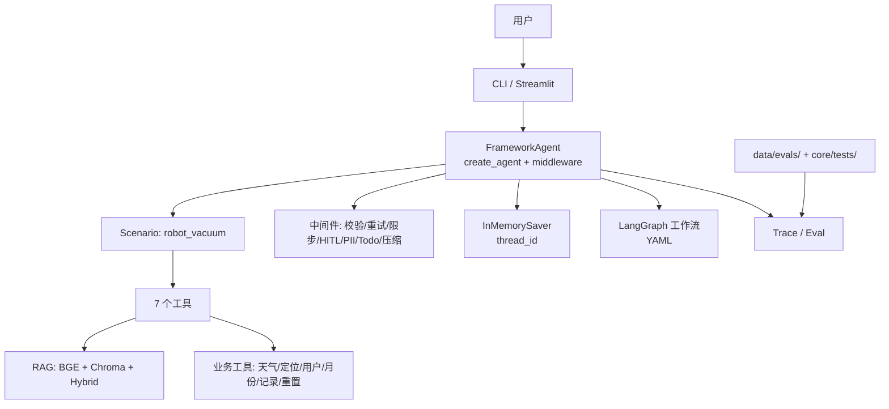

# 简历项目叙事（半周版）

> **目标**：用 3–4 天，把现有项目整理成一段 **2 分钟能讲清、经得起追问** 的简历叙事。
> **项目**：Agent Harness（扫地/扫拖机器人客服场景验证）
> **当前状态**：13 条行为用例 11 通过；RAG 评测集 42 条；DeepSeek `deepseek-chat` + 本地 BGE；HITL / Memory / LangGraph 工作流已跑通。
> **原则**：只讲真实做过的；小样本就说小样本；不把自建评测说成线上指标。
> **岗位重心**：Agent 开发 / LLM 应用工程师。**公开基准（τ²-bench、BFCL）为主证据**，自建 13/42 条为回归集；**RAG 只是工具级证据**，不作为项目主标题。

---

## 1. 一句话定位

> **一个带评测的 Agent Harness（客服场景验证）：把裸模型包装成有工具、有知识库、有权限、有记忆、能评测的系统。**

不要介绍成"我用 LangChain 做了一个聊天机器人"——那是 API wrapper 的叙事。

---

## 2. 30 秒版（电梯陈述）

> 我做了一个扫地机器人客服 Agent。它不只是接一个大模型：我把 RAG、7 个业务工具、参数校验、高风险操作审批、会话记忆和评测都做进了同一个 Harness。项目用 LangChain 1.x + LangGraph，聊天模型是 DeepSeek，Embedding 换成本地 BGE，省掉了 Embedding API 成本。我自建了 13 条行为用例和 42 条 RAG 评测集，目前 13 条行为用例通过 11 条，拒答和工具调用都做了专项测试。

---

## 3. 2 分钟版（问题 → 方案 → 结果 → 取舍）

### 3.1 背景与问题

"客服场景看起来简单，但 Demo 和可用系统之间差很多：

1. 知识库文档格式混杂，切分和检索不稳定；
2. 模型会选错工具、传错参数，甚至死循环；
3. 高风险操作不能直接执行；
4. 多轮对话会丢上下文；
5. 最重要的是：**没有评测，改完不知道是变好还是变坏**。"

### 3.2 我做了什么

"我把它拆成三层：

- **Harness 层**：`create_agent` + 中间件，负责循环、工具、上下文、权限、记忆；
- **业务场景层**：扫地机器人场景，7 个工具 + RAG + 报告流程；
- **评测层**：检索、生成、拒答、工具调用、公开基准抽样。

具体包括：

- RAG：文档解析 → 按类型切分 → 本地 BGE Embedding → Chroma → 向量 + BM25 混合检索；
- 工具：查询天气、定位、用户 ID、月份、使用记录、知识库检索、设备重置；
- 可靠性：参数校验中间件、工具错误回注、重试、最大步数、工具调用上限；
- 权限：`reset_device` 高风险工具接 `HumanInTheLoopMiddleware`，审批通过才执行；
- 记忆：LangGraph `InMemorySaver` + `thread_id`，同一会话保留历史；
- 工作流：用 LangGraph 把「检索→回答→拒答分流→引用校验」和「用户 ID→月份→使用记录→报告」做成 YAML 可配置流程；
- 评测：13 条 Agent 行为用例、42 条 RAG 评测集、RGB / MultiHop-RAG 抽样。"

### 3.3 结果

"目前能拿出的数字：

- 13 条 Agent 行为用例：**11 条通过**，工具调用用例 **13/13** 都调用了预期工具；
- τ²-bench retail **20 条抽样**：**Pass^1 0.90（18/20）**，DB 19/20、read 100/110、write 22/23，0 infra error；NL judge 用 DeepSeek 替代，非官方评分；
- BFCL v4 抽样 200 条：**函数选择 100/100、参数 exact 89/100、无关工具不调用 80/100**；
- RAG 评测集（DeepSeek + 本地 BGE）：42 条中总体 pass **38 条**，答案题 **28 pass + 2 partial / 32**，拒答 **10/10**，冲突 **1 pass / 2 partial / 2 fail**；
- 公开 RGB / MultiHop 抽样（Qwen 时期）：19/20 + 1 partial、6/12；DeepSeek 下待重跑；
- 本地 BGE 512 维，知识库 66 个 chunk，CPU 可跑；
- HITL reject 验证：拒绝后高风险工具没有执行；
- 会话记忆验证：同一 thread 下能记住上一轮名字。"

> DeepSeek 切换后，RAG 全量数字需要重跑；半周计划里安排。

### 3.4 关键取舍

- **没有上多 Agent**：客服任务顺序依赖强，handoff 成本大于收益；先做单 Agent + 工具。
- **没有把所有流程写进 Prompt**：用 LangGraph 工作流和 Scenario 分离，避免 Prompt 膨胀。
- **严格拒答 vs 答案完整性**：严格 Prompt 把拒答从 1/5 提到 10/10，但部分答案漏要点；这是下一步要调的 trade-off。
- **本地 BGE vs API Embedding**：本地省成本、无网络依赖，但模型能力有限；小知识库上 Hit@4 已经饱和，换大库需要重新评估。
- **最小 Harness**：没有一上来做 Multi-Agent、后台任务、Cron；按真实失败逐步加组件。

---

## 4. 简历 Bullet（三种版本）

### 最终投递版（版本 A：Agent 开发 / LLM 应用，推荐）

> **Agent Harness（工具调用型 Agent 运行时与评测，客服场景验证）｜Python / LangChain 1.x / LangGraph** | 个人项目
>
> - **Agent Runtime**：基于 LangChain 的 Agent 与中间件机制实现 ReAct Loop、7 个工具注册与调度、参数校验、工具错误回注、最大步数/工具调用上限；用 LangGraph Checkpoint 支持多轮状态与暂停/恢复，流式输出。
> - **上下文与场景**：以客服任务作为验证场景，接入上下文压缩、Todo 规划、PII 脱敏与 HITL 高风险审批；用 LangGraph 工作流编排「检索→回答→拒答校验」和「报告生成」，通过场景注册机制解耦框架与业务；模型支持 DeepSeek / DashScope 切换，Embedding 使用本地 BGE（512 维，CPU）。
> - **可量化效果**：BFCL v4 抽样 200 条，函数选择 100/100、参数 exact 89/100、无关工具不调用 80/100；τ²-bench retail 20 条抽样 Pass^1 0.90（DB 19/20，非官方 judge）；自建 42 条 RAG 评测集总体 pass 38/42、拒答 10/10；13 条 Agent 回归集 11/13。

### 版本 A：Agent / Harness 方向（推荐）

> 构建扫地机器人客服 Agent（LangChain 1.x + LangGraph）：`create_agent` 集成 7 个业务工具与 RAG，设计参数校验、工具错误回注、最大步数与工具调用上限；高风险设备重置接入 HITL 审批，会话状态用 Checkpoint 持久化。BFCL v4 抽样 200 条：函数选择 100/100、参数 exact 89/100、无关工具不调用 80/100；τ²-bench retail 20 条抽样 Pass^1 0.90（DB 19/20，NL judge 用 DeepSeek 替代）。

### 版本 B：RAG 方向

> 构建本地知识库 RAG：文档解析 → 差异化切分 → 本地 BGE Embedding → Chroma → 向量 + BM25 混合检索；自建 42 条评测集（正常/边界/冲突/不可回答），DeepSeek + 本地 BGE 下总体 pass 38/42、拒答 10/10；接入 RGB / MultiHop-RAG 公开基准抽样。

### 版本 C：平台 / 工程化方向

> 将 Agent 框架与业务场景解耦：通用 `FrameworkAgent` + Scenario 注册机制，业务只声明工具/提示词/权限；用 LangChain 内置中间件补齐 Todo、上下文压缩、PII、HITL、重试与工具调用上限；提供 CLI 测试入口、RAG 评测脚本与 YAML 工作流。

> 简历上只放 1–2 条，不要三条全放；面试时按岗位方向选择。

---

## 5. 架构图（可画在白板/PPT）



一句话讲架构：**"模型只负责决策，Harness 负责工具、上下文、状态、权限和评测。"**

---

## 6. 指标表（简历/面试口径）

| 指标 | 数值 | 状态 | 说明 |
|:---|:---|:---|:---|
| Agent 行为用例 | 11/13 通过 | ✅ 已跑 | DeepSeek + 本地 BGE，2026-10-27 |
| τ²-bench retail 20 条 | Pass^1 0.90；DB 19/20；read 100/110；write 22/23 | ✅ 已跑（DeepSeek NL judge 替代） | 20/114 base tasks；非官方评分 |
| BFCL v4 抽样 | 函数选择 100/100、参数 exact 89/100、无关工具不调用 80/100 | ✅ 已跑 | 100 simple_python + 100 irrelevance；简化评分 |
| 工具调用命中 | 13/13 | ✅ 已跑 | 期望工具全部被调用 |
| 高风险审批 | reject 后未执行 | ✅ 已验证 | `reset_device` |
| 会话记忆 | 同 thread 记住名字 | ✅ 已验证 | `InMemorySaver` |
| 本地 Embedding | 512 维，66 chunks | ✅ 已跑 | BGE small zh v1.5 |
| RAG 42 条总体 pass | **38/42（90.5%）** | ✅ DeepSeek 重跑 | 28 pass + 2 partial / 32 答案题；拒答 10/10；冲突 1 pass / 2 partial / 2 fail |
| 检索 Hit@4 / MRR | 100% / 1.0 | ✅ 42 条 | 语料小，已饱和；MRR 区分度有限 |
| 公开 RGB 抽样 | 19/20 + 1 partial（Qwen 时期） | ⚠️ 待重跑 | 非官方完整榜单 |
| 公开 MultiHop 抽样 | 6/12（Qwen 时期） | ⚠️ 待重跑 | 多跳/时序是弱项 |
| 检索 Hit@4 | 100%（小样本） | ⚠️ 饱和 | 语料太小，MRR 更有区分度 |
| 成本/延迟 | 未系统统计 | ❌ 待补 | 半周内至少记录 3 个典型 case |

**口径提醒**：
- 所有数字都来自自建小样本，不是线上生产数据；
- 公开 benchmark 是抽样，不是官方榜单成绩；
- 面试被问样本量时，直接说"13 条 / 42 条自建，公开集各 20/12 条抽样"。

---

## 7. 十个高频追问与回答

### Q1：为什么用 Agent，而不是普通 workflow？
> "知识问答和故障排查的分支不固定，需要模型决定调用哪个工具、是否二次检索；但报告生成是固定流程，所以我用 LangGraph 工作流，不强行让 Agent 自由发挥。判断标准是：路径是否需要模型动态决定。"

### Q2：为什么不用多 Agent？
> "客服任务顺序依赖强，子任务之间要频繁交换状态，handoff 成本大于收益。公开研究也显示多 Agent 在可并行、读多写少的任务上才有优势。我的下一步是只读 fan-out，不是把写操作拆给子 Agent。"

### Q3：RAG 效果怎么测？
> "检索层看 Hit@4、MRR；生成层看要点覆盖、引用有效性、拒答准确率；冲突题要求并列两个来源。评测集包含正常、边界、冲突、不可回答四类。公开集用 RGB 和 MultiHop-RAG 抽样做泛化验证。"

### Q4：13 条用例怎么来的？为什么只有 13 条？
> "13 条是行为回归集，不是完整 benchmark：7 条 RAG、4 条工具、1 条报告、1 条拒答，覆盖主要路径和失败模式。RAG 另有 42 条评测集。13 条的目标是快速回归，不是统计显著性。"

### Q5：你的拒答为什么失败？
> "DeepSeek 在退货问题上会给出行业通用政策，而不是说资料不足。这说明 Prompt 约束不够，或者检索结果里没有明确的空答案信号。我后来加了严格拒答 Prompt，拒答率上去了，但答案完整性下降——这是下一步要调的分级拒答。"

### Q6：HITL 怎么实现？模型自己拒绝怎么办？
> "用 `HumanInTheLoopMiddleware` 拦截高风险工具调用，返回审批请求，approve 才执行，reject 把原因回注给模型。DeepSeek 有时会自己先拒绝调用高风险工具，这时不会触发审批——这是双层保护，不是 Bug。"

### Q7：本地 BGE 效果够吗？
> "小知识库上够用，512 维、CPU 可跑、无 API 成本；但它的语义能力不如大模型 Embedding，知识库变大后要重新评估召回。我的判断标准是 Hit@4/MRR 和最终任务成功率，不是模型大小。"

### Q8：DeepSeek 工具调用稳定吗？
> "整体可用，但不同模型对同一 Prompt 的行为不同：Qwen 更愿意调用工具，DeepSeek 更保守，高风险工具会先拒绝。所以评测不能绑定单一模型，Harness 要允许切换 provider。"

### Q9：成本和延迟怎么样？
> "目前只做了定性优化：本地 Embedding 去掉了 Embedding API 成本，DeepSeek 比 Qwen 便宜。还没有系统的成本/延迟看板，这是项目下一步要补的。"

### Q10：这个项目最大的不足是什么？
> "评测样本小、没有线上流量、没有轨迹级评测和 CI 回归；另外 RAG 没有 Rerank 和 Query 改写。这些是我下一步的计划，不是已经完成的能力。"

---

## 8. 半周执行计划（4 天，每天 3–4 小时）

### Day 1：冻结项目 + 拿到 Agent 指标（已完成大部分）

- [x] 跑完 13 条 Agent 行为用例：11/13；
- [x] 确认工具调用命中 13/13；
- [ ] 从报告里挑 3 个演示 case：RAG 问答、报告生成、HITL reject；
- [ ] 记录这 3 个 case 的步数、工具调用、大致延迟；
- [ ] 写 30 秒版陈述，读三遍。

**输出**：`outputs/agent/agent_test_<scenario>_<timestamp>.md` + 3 个演示 case。

### Day 2：RAG 指标统一口径

- [ ] 用 DeepSeek + 本地 BGE 重跑 20 条原始 RAG 评测集（10 normal / 3 edge / 2 conflict / 5 unanswerable）；
- [ ] 跑 `python -m core.quality.runner judge` 复核；
- [ ] 记录 Hit@4、MRR、拒答、冲突、答案覆盖；
- [ ] 如果时间允许，重跑 RGB 20 条抽样；MultiHop 可跳过；
- [ ] 把指标填进第 6 节表格。

**命令**：
```bash
python test_entry.py rag retrieval --dataset data/evals/datasets/business/eval_set.jsonl
python test_entry.py rag generation --dataset data/evals/datasets/business/eval_set.jsonl
python test_entry.py rag judge
```

**输出**：`outputs/rag/eval_retrieval.md`、`eval_generation_judged.md`、一张指标表。

### Day 3：写叙事 + 简历 bullet + 追问

- [ ] 按第 3 节写 2 分钟稿，控制在 500–700 字；
- [ ] 按第 4 节选 1–2 条简历 bullet，填入真实数字；
- [ ] 把第 7 节 10 个问题各写 3–5 句答案；
- [ ] 画第 5 节架构图（白板/PPT/文档）；
- [ ] 检查所有数字口径，删掉无法证明的说法。

**输出**：一页项目叙事 + 一页追问答案 + 一张架构图。

### Day 4：演练 + 录像

- [ ] 出声讲 3 遍 2 分钟版，手机录音；
- [ ] 录 2 分钟屏幕演示（RAG 问答、报告、HITL reject）；
- [ ] 找 AI/同学做一次模拟面试，重点问 Q2/Q3/Q5/Q10；
- [ ] 根据卡壳点修改稿子；
- [ ] 最终版发给朋友/导师听一遍，确认"像做过的人"。

**输出**：2 分钟视频 + 最终稿 + 模拟面试复盘。

---

## 9. 不能说的话（诚实边界）

- ❌ "线上服务了多少用户 / 提升了多少业务指标"——没有生产流量。
- ❌ "13 条用例代表全部场景"——只是回归集。
- ❌ "RGB 19/20 是官方榜单成绩"——只是 20 条抽样。
- ❌ "MultiHop 6/12 说明模型不行"——样本小，且是多跳英文任务，不是业务结论。
- ❌ "独立设计了整个框架"——项目基于开源/教程演进，要说明哪些是自己改的。
- ✅ 可以说："自建小样本评测"、"公开集抽样"、"个人项目"、"下一步计划"。

---

## 10. 资料路径

- Agent 测试报告：运行 `python test_entry.py --all`，输出到 `outputs/agent/`（本地生成，不提交）
- RAG 评测报告：运行 `python test_entry.py rag retrieval/generation/judge`，输出到 `outputs/rag/`（本地生成，不提交）
- 公开基准报告：运行 `python test_entry.py bfcl ...` 或 `python -m core.quality.runner public`，输出到 `outputs/public/`
- 失败集：`data/evals/failures/`（已提交）
- HITL 演示：`core/tests/demos/hitl_demo.py`
- 记忆演示：`core/tests/demos/memory_demo.py`
- 工作流：`core/scenarios/robot_vacuum/graph.py`（rag_qa / report）
- 优化方向全景：`docs/design/agent-optimization-landscape.md`

---

## 11. 一句话总结

> **"我不是做了一个聊天机器人，我做了一个能评测、能审批、能恢复、能换模型的 Agent Harness；它的价值不在 Demo，而在于我知道它哪里会坏、怎么测、下一步怎么修。"**
